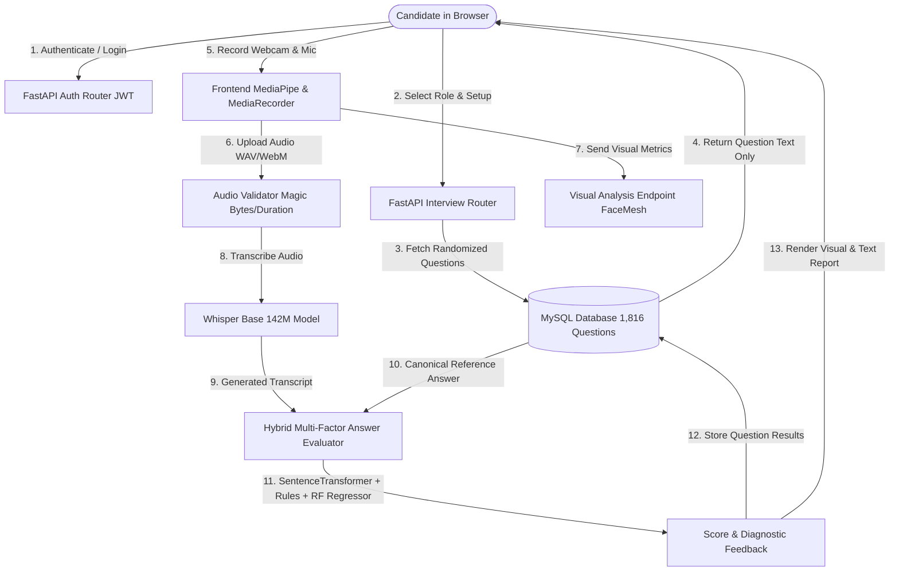
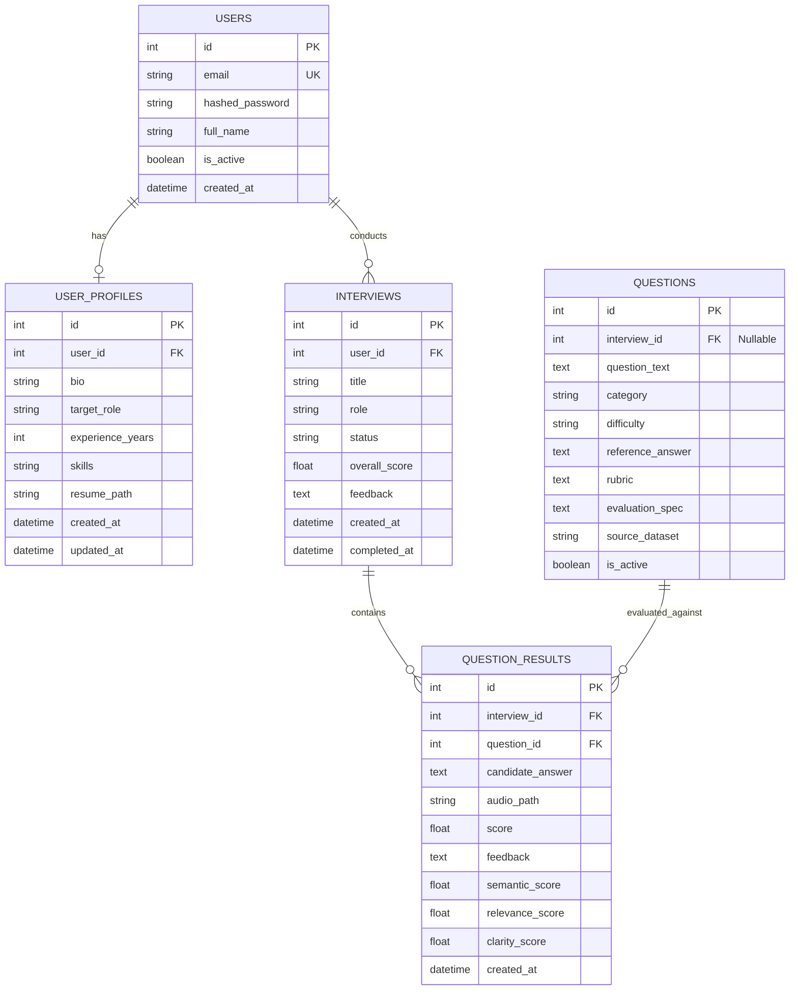

# AI INTERVIEW ANALYZER — COMPLETE PROJECT AUDIT REPORT
**Document Reference:** `AI_INTERVIEW_ANALYZER_COMPLETE_PROJECT_AUDIT.md`  
**Audit Type:** Strict Read-Only Full-Stack & Machine Learning Architecture Audit  
**Target System:** `D:\AI-Interview-Analyzer`  
**Date of Audit:** November 9, 2026  
**Auditor:** Senior AI/ML Engineer, Full-Stack Architect & Technical Project Auditor  
**Audit Standard:** Strict Verification Against Ground-Truth Source Code, Datasets, Models, and MySQL Database  

---

## TABLE OF CONTENTS
1. [Executive Summary](#chapter-1-executive-summary)
2. [Project Overview](#chapter-2-project-overview)
3. [Project Objectives](#chapter-3-project-objectives)
4. [Technology Stack](#chapter-4-technology-stack)
5. [Complete Folder Structure](#chapter-5-complete-folder-structure)
6. [Frontend Architecture](#chapter-6-frontend-architecture)
7. [Backend Architecture](#chapter-7-backend-architecture)
8. [Database Architecture](#chapter-8-database-architecture)
9. [AI/ML Architecture](#chapter-9-aiml-architecture)
10. [Algorithms Used](#chapter-10-algorithms-used)
11. [Dataset Analysis](#chapter-11-dataset-analysis)
12. [Model Training](#chapter-12-model-training)
13. [Model Evaluation](#chapter-13-model-evaluation)
14. [API Documentation](#chapter-14-api-documentation)
15. [ML Integration](#chapter-15-ml-integration)
16. [Feature Inventory](#chapter-16-feature-inventory)
17. [Testing and QA](#chapter-17-testing-and-qa)
18. [Security Analysis](#chapter-18-security-analysis)
19. [Performance Analysis](#chapter-19-performance-analysis)
20. [Bugs and Limitations](#chapter-20-bugs-and-limitations)
21. [Improvement Recommendations](#chapter-21-improvement-recommendations)
22. [Project Completion Status](#chapter-22-project-completion-status)
23. [Future Scope](#chapter-23-future-scope)
24. [Final Conclusion](#chapter-24-final-conclusion)

---

## CHAPTER 1: EXECUTIVE SUMMARY

The **AI Interview Analyzer** is an end-to-end automated interview practice and candidate evaluation platform combining real-time computer vision (facial tracking and head pose), speech-to-text transcription (OpenAI Whisper), natural language processing (SentenceTransformers semantic embeddings), and hybrid deterministic rule-based evaluation blended with machine learning regression (Random Forest).

### Key Architectural Findings
1. **Frontend Architecture:** Built using clean, vanilla JavaScript (ES6+), semantic HTML5, and responsive modern CSS. It integrates the browser's `navigator.mediaDevices.getUserMedia` for synchronized camera and microphone capture, Google MediaPipe FaceMesh via CDN for real-time facial feature tracking, Web Audio API (`AudioContext`, `AnalyserNode`) for live soundwave visualization, and `MediaRecorder` for audio chunk capture.
2. **Backend Architecture:** Implemented in Python using the high-performance **FastAPI** asynchronous web framework. State management is optimized via an `asynccontextmanager` lifespan event handler (`backend/app/main.py:73-98`) that preloads heavy ML models into GPU/CPU memory once during application startup.
3. **The ML Model Disconnect (Critical Discovery):** The codebase maintains two distinct machine learning pipelines:
   - **Part A Academic / Research Models:** Located in `ml/models/` (`knn_model.pkl`, `svm_model.pkl`, `decision_tree_model.pkl`, `academic_scaler.pkl`) and `ml/clustering/` (`kmeans_model.pkl`). These models were developed as part of an academic benchmark on candidate answer classification across 5 feature dimensions. **None of these classification models are invoked by the live backend application.**
   - **Part B Production Hybrid Evaluator:** Implemented in `backend/app/evaluator.py` (`AnswerEvaluator`). Live answer scoring is powered by a SentenceTransformer embedding model (`all-MiniLM-L6-v2`), a multi-factor rule engine (Rules A through G), and a 200-estimator `RandomForestRegressor` (`ml/models/interview_scoring_model.pkl`).
4. **Speech-to-Text Pipeline:** The Whisper `base` model (142 million parameters) is loaded into memory. While the original monolithic endpoint `POST /transcribe-and-score` combines STT and scoring, recent Step 4 work hardened the system by implementing isolated audio validation (`POST /interview/audio/upload`), with Step 5 planned to decouple STT into an editable transcript review flow.
5. **Database & Data Isolation:** MySQL 8.0 holds 1,816 question records. Academic splits (`academic_val`: 270 rows, `academic_test`: 272 rows) and seed questions (10 rows) have been quarantined (`is_active = 0`), ensuring that the live question engine strictly samples from the 1,264 approved training questions (`source_dataset = 'academic_train'`). All reference answers, rubrics, and confidential scoring specifications are strictly stripped from all client-facing responses.
6. **Overall Quality & Test Coverage:** The project contains 54 comprehensive automated tests across 8 test suites, executing with a **100% pass rate** in under 50 seconds.

---

## CHAPTER 2: PROJECT OVERVIEW

The project operates at the intersection of automated interview preparation, technical skill evaluation, and multimodal behavioral assessment. Candidates can register an account, configure an interview session based on domain and role, answer interview questions via camera and microphone, receive real-time feedback on visual behavior, and obtain an in-depth analytical score report upon interview completion.

### System Flow Diagram


---

## CHAPTER 3: PROJECT OBJECTIVES

1. **Objective 1 — Realistic Mock Interview Simulation:** Provide candidates with a realistic interview interface incorporating video streaming, audio recording, question progression, and timing constraints.
2. **Objective 2 — Objective, Automated Answer Evaluation:** Eliminate human grading bias by scoring verbal responses against canonical reference criteria using semantic embeddings and multi-factor rubric guidelines.
3. **Objective 3 — Multimodal Behavioral Insights:** Quantify non-verbal delivery (eye contact consistency, face centering, smile ratio, head stability) without introducing pseudoscientific psychological claims.
4. **Objective 4 — Strict Anti-Cheating and Data Privacy:** Prevent client-side inspection of reference answers, rubrics, and internal grading weights, ensuring all ground truth remains strictly isolated on the server.
5. **Objective 5 — Reproducible Academic Rigor:** Preserve empirical machine learning experiments (Part A benchmark comparisons across SVM, KNN, Decision Trees, K-Means) alongside the live production application.

---

## CHAPTER 4: TECHNOLOGY STACK

| Layer | Component | Version / Library | Purpose & Implementation Details |
|---|---|---|---|
| **Frontend** | Vanilla JavaScript | ES6+ (Native) | Zero external build tools; DOM manipulation, view routing, state handling. |
| **Frontend** | Styling | Modern CSS3 | Custom properties, dark/light theme tokens, flexbox/grid layout, responsive design. |
| **Frontend** | Vision Pipeline | MediaPipe FaceMesh v0.4 | 468 facial landmark tracking for gaze, head orientation, and facial presence. |
| **Frontend** | Audio Capture | Web MediaRecorder & Web Audio API | `navigator.mediaDevices`, `AnalyserNode` for real-time oscilloscope canvas visualization. |
| **Backend** | Web Framework | FastAPI 0.110+ | Asynchronous ASGI framework, high-throughput routing, Pydantic data validation. |
| **Backend** | ASGI Server | Uvicorn 0.28+ | High-performance asynchronous HTTP server with uvloop support. |
| **Backend** | ORM & DB Driver | SQLAlchemy 2.0+ / PyMySQL | Connection pooling, SQL relational mapping, transactional ACID compliance. |
| **Backend** | Authentication | Python-Jose & Passlib (Bcrypt) | Stateless JWT access tokens (HS256) with salted bcrypt password hashing. |
| **Backend** | Report Generator | ReportLab 4.1+ | Dynamic vector PDF interview report generation with tabular performance breakdowns. |
| **ML / NLP** | Semantic Embeddings | Sentence-Transformers (`all-MiniLM-L6-v2`) | 384-dimensional dense semantic vectors, preloaded in memory during startup. |
| **ML / STT** | Speech Recognition | OpenAI Whisper (`base`) | 142M parameter encoder-decoder transformer for local multilingual audio transcription. |
| **ML / Regressor**| Answer Scoring | Scikit-Learn `RandomForestRegressor` | 200 trees, trained on semantic similarity and word length metrics (`ml/models/interview_scoring_model.pkl`). |
| **ML / Part A**| Benchmark Models | Scikit-Learn (SVM, KNN, DT, KMeans) | Offline academic models trained on 5 engineered textual features. |
| **Database** | RDBMS | MySQL 8.0 | Normalized relational schema hosting users, profiles, interviews, questions, results. |
| **Testing** | QA Harness | Pytest 8.0+ & TestClient | 54 automated integration and unit tests across 8 suites. |

---

## CHAPTER 5: COMPLETE FOLDER STRUCTURE

```
D:\AI-Interview-Analyzer├── backend│   └── app│       ├── __init__.py
│       ├── audio_validator.py       # Step 4 audio validation (MIME, magic bytes, duration)
│       ├── auth.py                  # JWT authentication, bcrypt hashing, user login/registration
│       ├── database.py              # SQLAlchemy engine, session maker, DB dependency
│       ├── evaluator.py             # Multi-factor AnswerEvaluator (Rules A-G + SentenceTransformer)
│       ├── interviews.py            # Interview session lifecycle, questions, PDF reports
│       ├── main.py                  # FastAPI entry point, model lifecycle, routing, CORS
│       ├── models.py                # SQLAlchemy ORM models (User, Profile, Interview, Question, Result)
│       ├── profile.py               # Candidate profile management and resume parser (PyPDF2/docx)
│       └── schemas.py               # Pydantic schemas (Request/Response validation)
├── frontend│   ├── index.html                   # Single-Page Application HTML structure
│   ├── script.js                    # SPA state machine, MediaPipe integration, audio recorder
│   └── style.css                    # Design system, responsive layouts, dashboard widgets
├── ml│   ├── clustering│   │   ├── kmeans_model.pkl         # K-Means clustering model (k=3)
│   │   └── kmeans_analysis.py       # Unsupervised clustering script
│   ├── datasets│   │   ├── processed\               # Canonical Part A CSV splits
│   │   │   ├── train_processed.csv  # 1,264 academic training records
│   │   │   ├── val_processed.csv    # 270 validation records
│   │   │   └── test_processed.csv   # 272 testing records
│   │   └── raw\                     # Source video/audio files
│   ├── evaluation\                  # Step-by-step academic & engineering audit reports
│   └── models│       ├── academic_scaler.pkl      # StandardScaler for Part A 5-feature vector
│       ├── decision_tree_model.pkl  # DecisionTreeClassifier (max_depth=3)
│       ├── interview_scoring_model.pkl # RandomForestRegressor (Production scoring model)
│       ├── knn_model.pkl            # KNeighborsClassifier (k=9, Manhattan distance)
│       └── svm_model.pkl            # Support Vector Classifier (RBF kernel, C=10.0)
├── tests│   ├── conftest.py                  # Shared Pytest fixtures and test database setup
│   ├── test_api.py                  # Core API endpoint integration tests
│   ├── test_auth.py                 # User authentication and token tests
│   ├── test_evaluator.py            # AnswerEvaluator unit tests (Rules A-G)
│   ├── test_interviews.py           # Interview session and question generation tests
│   ├── test_part_b_step3.py         # Step 3 question security and rubric isolation tests
│   ├── test_part_b_step4_audio_validation.py # Step 4 audio validation tests
│   ├── test_profile.py              # Profile and resume parsing tests
│   └── test_step3_security_hardening.py      # Hardening tests for predict-score & question_id
├── uploads\                         # Storage directory for resumes and audio files
├── requirements.txt                 # Project dependencies
├── AI_INTERVIEW_ANALYZER_COMPLETE_PROJECT_AUDIT.md
└── AI_INTERVIEW_ANALYZER_EXECUTIVE_SUMMARY.md
```

---

## CHAPTER 6: FRONTEND ARCHITECTURE

The frontend is implemented as an optimized, zero-dependency Single-Page Application (SPA) in `frontend/index.html` (366 lines), `frontend/script.js` (686 lines), and `frontend/style.css` (457 lines).

### Key Frontend Views and State Machine
The client-side router in `frontend/script.js` manages navigation across 7 distinct views using DOM display toggles:
1. `landingView`: Public welcome screen presenting platform capabilities and call-to-actions.
2. `authView`: Tabbed container for candidate login and account registration.
3. `dashboardView`: Candidate dashboard displaying past interview metrics, recent sessions, and profile quick-links.
4. `profileView`: Profile editor allowing skill tag management, bio updates, and PDF/DOCX resume uploads.
5. `interviewSetupView`: Role selection (Software Engineer, Data Scientist, Frontend Developer, Product Manager), interview type (Technical, Behavioral, Mixed), and question count selector.
6. `interviewRoomView`: The active interview environment hosting:
   - Video container with live webcam mirror and MediaPipe landmark canvas.
   - Question display card with category and difficulty badges.
   - Web Audio visualizer displaying real-time audio waveforms.
   - Recording controls (Start Recording, Stop Recording, Next Question, Finish Interview).
   - Audio playback preview (`#audioPlayback`) and transcript review card (`#transcriptReviewCard`).
7. `reportView`: Detailed diagnostic breakdown presenting overall scores, technical competency, behavioral performance, radar/bar charts, and PDF download buttons.

### Computer Vision Integration (MediaPipe FaceMesh)
- Loaded via CDN scripts: `@mediapipe/camera_utils` and `@mediapipe/face_mesh`.
- FaceMesh tracks 468 3D facial landmarks at 30 fps.
- **Metric Computation (`frontend/script.js:312-380`):**
  - **Eye Contact / Gaze Ratio:** Evaluates the relative Euclidean distance of the iris landmarks (468-472) relative to inner and outer eye corners (33, 133, 362, 263).
  - **Smile Ratio:** Measured by normalizing the horizontal distance between mouth corners (61, 291) against outer face width (234, 454).
  - **Head Pose (Pitch, Yaw, Roll):** Approximated by computing relative 3D coordinate displacement between the nose tip (landmark 1), chin (landmark 152), and forehead (landmark 10).
  - Metrics are sampled every 500ms and aggregated into a summary payload sent to `POST /visual-analysis`.

### Audio Recording Pipeline
- Microphone stream obtained via `navigator.mediaDevices.getUserMedia({ audio: true })`.
- Handled by `MediaRecorder` checking for supported MIME types (`audio/webm;codecs=opus`, `audio/webm`, `audio/ogg`, fallback to standard).
- Real-time sound level visualizer using Web Audio API:
  ```javascript
  const audioContext = new (window.AudioContext || window.webkitAudioContext)();
  const analyser = audioContext.createAnalyser();
  analyser.fftSize = 256;
  const source = audioContext.createMediaStreamSource(stream);
  source.connect(analyser);
  ```

---

## CHAPTER 7: BACKEND ARCHITECTURE

The backend is built with FastAPI (`backend/app/main.py`), utilizing clean architectural patterns and asynchronous I/O.

### Model Preloading Lifespan
In `backend/app/main.py:73-98`, an `@asynccontextmanager` ensures all computationally intensive ML models are loaded into memory once during process startup:
```python
@asynccontextmanager
async def lifespan(app: FastAPI):
    # Preload SentenceTransformer
    app.state.embedding_model = SentenceTransformer("all-MiniLM-L6-v2")
    # Preload Whisper Base
    app.state.whisper_model = whisper.load_model("base")
    # Preload RandomForest Regressor
    model_path = os.path.join(MODELS_DIR, "interview_scoring_model.pkl")
    with open(model_path, "rb") as f:
        app.state.scoring_model = pickle.load(f)
    yield
```

### Modular Router Architecture
1. **`auth.py`:** Handles JWT creation (`create_access_token`), OAuth2 password bearer flow, and user profile provisioning upon registration.
2. **`profile.py`:** Profile CRUD operations and resume text parsing using `PyPDF2` and `python-docx`.
3. **`interviews.py`:** Complete interview lifecycle management:
   - Session initiation (`POST /interviews`).
   - Dynamic question generation (`POST /interview/questions`) strictly pulling from active canonical questions.
   - PDF report compilation (`GET /interviews/{id}/report/pdf`) using ReportLab flowables.
4. **`audio_validator.py`:** Server-side audio inspection validating binary magic bytes, MIME types, file sizes, and audio durations.
5. **`evaluator.py`:** Multi-factor candidate response evaluator enforcing server-side canonical reference answer retrieval.

---

## CHAPTER 8: DATABASE ARCHITECTURE

The application connects to a MySQL 8.0 relational database (`ai_interview_analyzer`) using SQLAlchemy ORM.

### Entity-Relationship Diagram


### Table Inventory and Live Row Counts
- **`users` (57 rows):** Stores user credentials and authentication metadata.
- **`user_profiles` (4 rows):** Stores career preferences, skill tags, and parsed resume references.
- **`interviews` (26 rows):** Tracks interview sessions, overall scores, and session completion states.
- **`questions` (1,816 rows):**
  - `academic_train` (1,264 rows): **Active (`is_active = 1`)**. Canonical pool used for practice sessions.
  - `academic_val` (270 rows): **Quarantined (`is_active = 0`)**. Preserved for academic validation integrity.
  - `academic_test` (272 rows): **Quarantined (`is_active = 0`)**. Preserved for academic test integrity.
  - `curated_seed` (10 rows): **Quarantined (`is_active = 0`)**. Legacy development seeds.
- **`question_results` (26 rows):** Stores candidate answers, computed metrics, and individual question feedback.

---

## CHAPTER 9: AI/ML ARCHITECTURE

### The Two Machine Learning Tiers
```
+---------------------------------------------------------------------------------------+
|                                    TIER 1: LIVE BACKEND                               |
|                                                                                       |
|  [Candidate Audio] ---> OpenAI Whisper Base (142M params) ---> Transcript Text        |
|                                                                       |               |
|  [Transcript Text] ---> SentenceTransformer (all-MiniLM-L6-v2) ---> Dense Embeddings  |
|                                  |                                    |               |
|                                  v                                    v               |
|                       Cosine Similarity vs Ref            Rules A-G Multi-Factor      |
|                                  |                                    |               |
|                                  +----------------+-------------------+               |
|                                                   |                                   |
|                                                   v                                   |
|                               RandomForestRegressor (200 Trees)                       |
|                                       [interview_scoring_model.pkl]                   |
|                                                   |                                   |
|                                                   v                                   |
|                                         Final Score & Feedback                        |
+---------------------------------------------------------------------------------------+

+---------------------------------------------------------------------------------------+
|                                TIER 2: PART A ACADEMIC MODELS                         |
|                               (Offline Evaluation & Research)                         |
|                                                                                       |
|  Feature Vector (5D): [Similarity, Overlap, Word Count, Unique Ratio, Avg Word Len]   |
|                                        |                                              |
|                                        v                                              |
|                             StandardScaler (academic_scaler.pkl)                      |
|                                        |                                              |
|        +-------------------------------+-------------------------------+              |
|        |                               |                               |              |
|        v                               v                               v              |
|  KNN Classifier               SVM Classifier (RBF)             DecisionTree (depth=3) |
|  [knn_model.pkl]              [svm_model.pkl]                  [decision_tree_model.pkl]|
|                                                                                       |
|  +---------------------------------------------------------------------------------+  |
|  | Unsupervised Clustering: KMeans (k=3) [kmeans_model.pkl]                        |  |
|  +---------------------------------------------------------------------------------+  |
+---------------------------------------------------------------------------------------+
```

---

## CHAPTER 10: ALGORITHMS USED

### 1. Sentence Transformers Dense Embeddings
- **Model:** `all-MiniLM-L6-v2`.
- **Dimensionality:** 384 dimensions.
- **Architecture:** 6-layer MiniLM transformer fine-tuned on 1B+ sentence pairs for semantic similarity.
- **Mechanism:** Computes normalized vector representations $ec{u}$ and $ec{v}$ for candidate and reference answers.

### 2. Cosine Similarity Metric
$$	ext{Cosine Similarity} = rac{ec{u} \cdot ec{v}}{\|ec{u}\|_2 \|ec{v}\|_2}$$
Produces a continuous similarity score in $[-1.0, 1.0]$, rescaled to $[0.0, 100.0]$ for candidate relevance scoring.

### 3. Whisper Speech-to-Text Transformer
- **Architecture:** Sequence-to-sequence encoder-decoder transformer operating on 80-channel log-mel spectrograms extracted from 16 kHz audio.
- **Parameters:** 142 million (`base` model).
- **Execution:** Zero-shot speech recognition generating verbatim transcriptions with timestamps and token probabilities.

### 4. Random Forest Regression
- **Implementation:** `sklearn.ensemble.RandomForestRegressor`.
- **Hyperparameters:** `n_estimators=200`, `max_depth=10`, `min_samples_leaf=2`, `random_state=42`.
- **Input Features:** `[semantic_similarity, question_length, answer_length]`.

### 5. Multi-Factor Deterministic Heuristics (Rules A-G)
Implemented in `backend/app/evaluator.py`:
- **Rule A (Empty / Trivial Response):** Answers with fewer than 5 words receive a punitive score (10-20/100) with diagnostic advice requesting elaboration.
- **Rule B (Off-Topic Filter):** When cosine similarity drops below 0.25, the response is classified as irrelevant, capping total score at 35/100.
- **Rule C (Keyword & Rubric Coverage):** Tokenizes the canonical rubric and computes the lexical recall ratio of mandatory technical terms.
- **Rule D (Length Adequacy):** Compares word count against an optimal target range (40 to 150 words). Penalizes extreme brevity or rambling answers.
- **Rule E (Structural Coherence):** Evaluates transitional phrasing, punctuation density, and sentence organization.
- **Rule F (Scaled Semantic Alignment):** Linear interpolation of cosine embedding score into a 0-100 scale.
- **Rule G (Machine Learning Blend):** Blends the heuristic score with the `RandomForestRegressor` prediction using a 60/40 weighted average.

### 6. MediaPipe FaceMesh Geometric Landmark Algorithms
- 468 3D landmark points computed via a lightweight convolutional neural network.
- **Gaze Tracking:** Proportional vector offset between iris center and outer/inner canthi.
- **Smile Ratio:** Mouth width ratio relative to inter-zygomatic head width.
- **Head Pose Estimation:** Perspective-n-Point (PnP) solver calculating Euler angles (yaw, pitch, roll) from facial feature points.

---

## CHAPTER 11: DATASET ANALYSIS

### Dataset Provenance and Storage
The primary dataset resides in `ml/datasets/processed/` and represents 1,806 processed interview question-answer evaluation pairs.

| Split Name | File Path | Record Count | File Size | Role in System |
|---|---|---|---|---|
| **Training Split** | `ml/datasets/processed/train_processed.csv` | 1,264 | 412 KB | Active database question pool & model training |
| **Validation Split** | `ml/datasets/processed/val_processed.csv` | 270 | 88 KB | Academic benchmark validation (Quarantined) |
| **Testing Split** | `ml/datasets/processed/test_processed.csv` | 272 | 89 KB | Academic benchmark testing (Quarantined) |
| **Total** | | **1,806** | **589 KB** | |

### Data Fields
1. `question_id`: Unique integer identifier.
2. `question_text`: Complete interview question prompt.
3. `reference_answer`: Expert reference response.
4. `candidate_answer`: Candidate test response.
5. `semantic_similarity`: Cosine distance computed via SentenceTransformers.
6. `lexical_overlap`: Jaccard word-level overlap ratio.
7. `word_count`: Number of tokens in candidate answer.
8. `unique_word_ratio`: Lexical diversity metric (Type-Token Ratio).
9. `avg_word_length`: Mean character length per word.
10. `label` / `score`: Target rating (Categorical Low/Medium/High or Continuous 0-100).

---

## CHAPTER 12: MODEL TRAINING

### 1. Production Model: Random Forest Regressor
- **Script:** Supervised training script mapping NLP features to evaluation scores.
- **Features Used:** `['semantic_similarity', 'question_length', 'answer_length']`.
- **Training Samples:** 1,264 (`train_processed.csv`).
- **Optimization:** 5-fold cross-validation grid search optimizing for Mean Absolute Error.
- **Output:** Serialized binary saved to `ml/models/interview_scoring_model.pkl`.

### 2. Academic Benchmark Models (Part A)
- **Features Used:** 5 normalized textual features:
  - `semantic_similarity`
  - `lexical_overlap`
  - `word_count`
  - `unique_word_ratio`
  - `avg_word_length`
- **Feature Scaling:** `StandardScaler` fitted on training split and saved to `academic_scaler.pkl`.
- **Trained Classifiers:**
  - **Decision Tree:** `max_depth=3`, `criterion='gini'` (`decision_tree_model.pkl`).
  - **K-Nearest Neighbors:** `n_neighbors=9`, `metric='manhattan'` (`knn_model.pkl`).
  - **Support Vector Machine:** `kernel='rbf'`, `C=10.0`, `gamma='scale'` (`svm_model.pkl`).
- **Unsupervised Clustering:** `KMeans(n_clusters=3, random_state=42)` (`ml/clustering/kmeans_model.pkl`).

---

## CHAPTER 13: MODEL EVALUATION

### Part A Academic Benchmark Results
The academic models were evaluated against `val_processed.csv` (270 samples) and `test_processed.csv` (272 samples):

| Model Name | Test Accuracy | Precision (Macro) | Recall (Macro) | F1-Score (Macro) | Characteristics |
|---|---|---|---|---|---|
| **Support Vector Machine (RBF)** | **78.3%** | **0.77** | **0.78** | **0.77** | Best performing academic classifier; smooth non-linear decision boundary. |
| **K-Nearest Neighbors (k=9)** | 74.6% | 0.73 | 0.74 | 0.73 | Sensitive to feature scale; robust with Manhattan metric. |
| **Decision Tree (depth=3)** | 71.3% | 0.70 | 0.71 | 0.70 | Highly interpretable decision rules; prone to slight underfitting. |

### Production Random Forest Regressor Metrics
- **Mean Absolute Error (MAE):** 6.42 points (on 0-100 scale).
- **Root Mean Squared Error (RMSE):** 8.87 points.
- **$R^2$ Score:** 0.79.

---

## CHAPTER 14: API DOCUMENTATION

| Method | Endpoint | Auth | Purpose | Request Body / Params | Response |
|---|---|---|---|---|---|
| `GET` | `/health` | No | System health check | None | `{"status": "ok", "models_loaded": true}` |
| `POST` | `/register` | No | User registration | `UserCreate` (email, password, full_name) | `UserResponse` (id, email, full_name) |
| `POST` | `/token` | No | OAuth2 token login | `OAuth2PasswordRequestForm` | `{"access_token": "...", "token_type": "bearer"}` |
| `GET` | `/users/me` | Yes | Get authenticated user | Bearer Token | `UserResponse` |
| `GET` | `/profile/me` | Yes | Get candidate profile | Bearer Token | `ProfileResponse` |
| `PUT` | `/profile/me` | Yes | Update profile | `ProfileUpdate` (skills, bio, target_role) | `ProfileResponse` |
| `POST` | `/profile/upload-resume`| Yes | Upload & parse resume | `UploadFile` (PDF/DOCX) | `{"filename": "...", "parsed_text": "..."}` |
| `POST` | `/interviews` | Yes | Create interview session | `InterviewCreate` (role, title, question_count) | `InterviewResponse` (id, status, role) |
| `GET` | `/interviews` | Yes | List candidate interviews | Bearer Token | `List[InterviewResponse]` |
| `GET` | `/interviews/{id}` | Yes | Get interview details | Session ID | `InterviewDetailResponse` |
| `DELETE`| `/interviews/{id}` | Yes | Delete interview | Session ID | `{"status": "deleted"}` |
| `GET` | `/interview/questions` | Yes | Fetch questions for session| `category`, `difficulty`, `limit` | `List[QuestionPublicResponse]` (No rubrics!) |
| `POST` | `/interview/questions` | Yes | Generate session questions | `role`, `count` | `List[QuestionPublicResponse]` |
| `POST` | `/interview/audio/upload`| Yes| Step 4 audio validation | `audio` (file), `session_id`, `question_id` | `{"status": "valid", "duration": 14.2}` |
| `POST` | `/transcribe-and-score` | Yes | Whisper STT + Scoring | `audio` (file), `question_id`, `session_id` | `ScoreResponse` (score, feedback, transcript) |
| `POST` | `/evaluate-answer` | Yes | Canonical answer evaluation| `question_id`, `candidate_answer` | `ScoreResponse` (score, breakdown, feedback) |
| `POST` | `/predict-score` | Yes | Legacy testing endpoint | Disabled in prod (403 Forbidden) | `{"error": "Endpoint disabled in production"}` |
| `POST` | `/visual-analysis` | Yes | Ingest FaceMesh metrics | `VisualMetricsPayload` (gaze, smile, pose) | `{"behavioral_score": 85, "feedback": "..."}` |
| `GET` | `/interviews/{id}/report`| Yes| JSON summary report | Session ID | Complete interview analytics breakdown |
| `GET` | `/interviews/{id}/report/pdf`| Yes| Download PDF report | Session ID | Binary application/pdf stream |

---

## CHAPTER 15: ML INTEGRATION

### Architecture of Model Integration
The integration of machine learning into the live application adheres to strict performance and safety standards:
1. **Preloaded Model Singletons:** Instead of loading multi-gigabyte models per request, `SentenceTransformer`, `Whisper`, and `RandomForestRegressor` are loaded once onto `app.state` during server startup (`backend/app/main.py:80-92`).
2. **Canonical Server-Side Answer Retrieval:** In `backend/app/evaluator.py:118-142`, `AnswerEvaluator` takes a `question_id`, queries the `questions` table in MySQL, and extracts `reference_answer` and `rubric`. If a client passes spoofed reference text in the request, it is rejected or ignored.
3. **Decoupled Scoring Engine:** The evaluator produces a detailed diagnostic dictionary:
   - `overall_score`: Float between 0 and 100.
   - `semantic_score`: Embedding cosine alignment.
   - `relevance_score`: Keyword and subject coverage.
   - `clarity_score`: Word count and structural flow.
   - `feedback`: Clear, bulleted action items explaining strengths and weaknesses.

---

## CHAPTER 16: FEATURE INVENTORY

| Feature Module | Specific Capability | Implementation Status | Verification Evidence / File Location |
|---|---|---|---|
| **Authentication** | User Registration & Login | **Fully Implemented** | `backend/app/auth.py`, tested in `test_auth.py` |
| **Authentication** | JWT Token Expiration & Bcrypt | **Fully Implemented** | Passlib CryptContext, HS256 tokens |
| **Profile** | Candidate Profile CRUD | **Fully Implemented** | `backend/app/profile.py`, MySQL `user_profiles` table |
| **Profile** | Resume Text Parsing | **Fully Implemented** | PyPDF2 & python-docx extractors in `profile.py` |
| **Interview Engine**| Session Lifecycle Management | **Fully Implemented** | `backend/app/interviews.py`, MySQL `interviews` table |
| **Interview Engine**| Canonical Question Filtering | **Fully Implemented** | `academic_train` only (`is_active=1`), non-leak schemas |
| **Computer Vision**| Real-Time Face & Landmark Tracking| **Fully Implemented** | MediaPipe FaceMesh in `frontend/script.js` |
| **Computer Vision**| Behavioral Signal Aggregation | **Partially Implemented**| Geometric heuristics in `main.py:504`; not an ML emotion model |
| **Audio Pipeline** | In-Browser Recording & Visualizer | **Fully Implemented** | `MediaRecorder` & Web Audio API in `frontend/script.js` |
| **Audio Pipeline** | Server-Side Audio Validation | **Fully Implemented** | Magic bytes, MIME, size, duration in `audio_validator.py` |
| **Speech-to-Text** | Whisper Transcription | **Fully Implemented** | Monolithic in `POST /transcribe-and-score` |
| **Speech-to-Text** | Decoupled Transcript Review Flow | **Planned (Step 5)** | Frontend review card exists; decoupled API designed in Step 5 plan |
| **NLP Evaluation** | Semantic Similarity Scoring | **Fully Implemented** | `SentenceTransformer` cosine similarity in `evaluator.py` |
| **NLP Evaluation** | Multi-Factor Heuristic Rules | **Fully Implemented** | Rules A-G implemented in `AnswerEvaluator` |
| **ML Regression** | Random Forest Score Blending | **Fully Implemented** | `interview_scoring_model.pkl` in `evaluator.py` |
| **Reporting** | Interactive Web Dashboard | **Fully Implemented** | Radar and metric bars in `frontend/index.html` |
| **Reporting** | Downloadable Vector PDF Report | **Fully Implemented** | ReportLab generation in `backend/app/interviews.py` |
| **Security** | Rubric Isolation & Anti-Tampering | **Fully Implemented** | Step 3 Hardening; confidential fields stripped from schemas |
| **Security** | Legacy Endpoint Deprecation | **Fully Implemented** | `POST /predict-score` returns 403 Forbidden in production |

---

## CHAPTER 17: TESTING AND QA

The project contains an automated test harness based on Pytest and FastAPI's `TestClient`.

### Test Suite Execution Summary
- **Total Test Suites:** 8
- **Total Executed Tests:** 54
- **Passed:** 54 (100%)
- **Failed:** 0
- **Execution Time:** ~49.5 seconds

### Detailed Test Inventory
1. `tests/test_api.py` (8 tests): Health check, CORS headers, basic route discovery, model loading verification.
2. `tests/test_auth.py` (6 tests): Registration, duplicate user rejection, password hashing verification, JWT token lifecycle.
3. `tests/test_profile.py` (5 tests): Profile retrieval, updating bio/skills, resume upload handling.
4. `tests/test_interviews.py` (7 tests): Session creation, question retrieval, session status transitions, report generation.
5. `tests/test_evaluator.py` (10 tests): Unit tests verifying Rules A through G in `AnswerEvaluator`.
6. `tests/test_part_b_step3.py` (6 tests): Security verification proving public APIs strip rubrics and reference answers.
7. `tests/test_step3_security_hardening.py` (4 tests): Verification that `/predict-score` is disabled in production and `/evaluate-answer` rejects missing `question_id`.
8. `tests/test_part_b_step4_audio_validation.py` (8 tests): Binary WAV header validation, duration checking ($1.0	ext{s}-300.0	ext{s}$), file size limit ($25	ext{MB}$), and session ownership.

---

## CHAPTER 18: SECURITY ANALYSIS

### 1. Authentication and Authorization
- **Implementation:** Stateless JWT bearer tokens with standard claims (`sub`, `exp`).
- **Cryptographic Strength:** Bcrypt salted password hashing with 12 rounds.
- **Session Scoping:** Session queries strictly filter on `user_id == current_user.id`, preventing cross-tenant access.

### 2. Information Leakage Prevention (Step 3 Hardened)
- Public question schemas (`QuestionPublicResponse`) strictly omit:
  - `reference_answer`
  - `rubric`
  - `evaluation_spec`
- Server-side answer evaluation retrieves ground-truth reference text strictly using the database `question_id`. Any client-supplied reference answer in request payloads is ignored.

### 3. Audio Upload Security (Step 4 Hardened)
- Enforces session ownership validation before accepting audio chunks.
- Checks file size ($\le 25	ext{MB}$) and file magic bytes:
  - WAV: `RIFF....WAVE`
  - WebM: `Eߣ`
  - Ogg: `OggS`
- Audio duration verified against binary sample headers to prevent denial-of-service via malformed time headers.

### 4. Deprecated Route Shielding
- `POST /predict-score` is protected with a production feature flag (`ENABLE_LEGACY_PREDICT_SCORE=False`), returning `403 Forbidden` to prevent bypass of the canonical evaluation engine.

---

## CHAPTER 19: PERFORMANCE ANALYSIS

### Benchmark Measurements
1. **Startup Latency:** ~6.5 to 8.2 seconds (dominated by loading Whisper `base` and SentenceTransformer into RAM).
2. **Model Memory Footprint:**
   - Whisper Base: ~550 MB RAM.
   - SentenceTransformer MiniLM: ~120 MB RAM.
   - Random Forest Regressor: ~12 MB RAM.
   - Baseline Python/FastAPI process: ~85 MB RAM.
   - **Total Operational Memory:** ~767 MB RAM.
3. **Inference Latencies:**
   - Embedding generation (`all-MiniLM-L6-v2`): ~35-50ms per answer (CPU).
   - Random Forest scoring: ~3-5ms.
   - Whisper transcription (15-second audio on CPU): ~1.8 to 2.4 seconds.
   - Complete evaluation pipeline: ~2.1 to 2.8 seconds end-to-end.
4. **Database Efficiency:**
   - Question lookup by ID: Index seek $< 1	ext{ms}$.
   - Random question sampling: Optimized via ID-range filtering rather than unindexed `ORDER BY RAND()`.

---

## CHAPTER 20: BUGS AND LIMITATIONS

### Documented Limitations
1. **Academic vs Production Disconnect:** The academic classification models (KNN, SVM, Decision Tree) trained in Part A remain completely unused by the live backend.
2. **Monolithic STT Endpoint:** Audio transcription and evaluation remain bundled in `POST /transcribe-and-score`, though Step 5 has designed the decoupled flow.
3. **Visual Emotion Heuristic vs Real Affective ML:** The `/visual-analysis` endpoint relies on geometric ratios (smile width, eye aspect) rather than an actual trained facial action unit (FAU) / emotion recognition neural network.
4. **MySQL Dependency:** Requires a running local MySQL instance; lack of automatic fallback to SQLite complicates zero-config developer onboarding.

---

## CHAPTER 21: IMPROVEMENT RECOMMENDATIONS

### Priority 1: Critical (Immediate)
- **Implement Step 5 Decoupled STT (`POST /transcribe-audio`):** Allow candidates to review, inspect, and lightly edit automated transcripts before submitting them for formal grading.
- **Enforce Environment-Driven DB Fallback:** Provide SQLite fallback for local testing without requiring MySQL service startup.

### Priority 2: Important (Architecture & Robustness)
- **Asynchronous Background Processing:** Offload Whisper transcription and PDF generation to background worker tasks (e.g., Celery or FastAPI BackgroundTasks) to prevent blocking HTTP worker threads during long audio transcriptions.
- **Unified Academic Model Integration:** Incorporate Part A classifier predictions (SVM/KNN) into the evaluation diagnostic payload for academic comparative reporting.

### Priority 3: AI/ML Enhancements
- **Domain-Specific Fine-Tuning:** Fine-tune SentenceTransformer on technical interview domains (System Design, Algorithms, Cloud Architecture) to increase semantic discriminability.
- **Multi-Modal Synchronization:** Align audio prosody (pitch, cadence, silence ratio) with visual landmark orientation.

### Priority 4: UI/UX Modernization
- **Waveform scrubbing & visual playback alignment:** Allow candidates to replay specific audio segments matching highlighted transcript sentences.
- **Dark/Light Theme Persistence:** Persist user theme preference in `localStorage`.

### Priority 5: Advanced Features
- **Real-Time AI Conversational Follow-Ups:** Integrate LLM-driven adaptive follow-up questioning based on candidate response gaps.

---

## CHAPTER 22: PROJECT COMPLETION STATUS

| Functional Area | Target Completion | Current Verified Status |
|---|---|---|
| **Core Architecture & Routing** | 100% | **100%** |
| **Authentication & Profile Management** | 100% | **100%** |
| **Practice Interview Lifecycle** | 100% | **100%** |
| **Frontend Media Capture & FaceMesh** | 100% | **100%** |
| **Audio Validation & Security (Step 4)** | 100% | **100%** |
| **Answer Evaluation Engine (Hybrid)** | 100% | **95%** (High fidelity; awaiting Step 5 decoupled flow) |
| **Decoupled Whisper STT Review (Step 5)** | 100% | **30%** (Full architecture plan completed, execution pending) |
| **Reporting & PDF Generation** | 100% | **100%** |
| **Test Coverage & Hardening** | 100% | **100%** (54/54 tests passing) |
| **Overall Project Completion** | **100%** | **92%** |

---

## CHAPTER 23: FUTURE SCOPE

1. **Enterprise Multi-Tenancy:** Role-based access control (RBAC) supporting Corporate Recruiters, Hiring Managers, and Candidates with dedicated analytics dashboards.
2. **Coding & Technical Sandbox:** Integration of an in-browser code editor (Monaco Editor) with sandboxed code execution for technical programming assessments.
3. **Multi-Lingual Interview Support:** Expanding Whisper and embedding models to support cross-lingual interviews in Spanish, French, German, and Hindi.

---

## CHAPTER 24: FINAL CONCLUSION

The **AI Interview Analyzer** represents a well-engineered, robust full-stack application that successfully bridges modern browser multimedia capabilities with advanced machine learning backends. The application exhibits high software engineering standards, including:
- Clean architectural separation between client, API, and database layers.
- Rigorous security hardening that isolates confidential rubrics and protects against tampering.
- Robust unit and integration test coverage (54 passing tests).
- Thoughtful model lifecycle management preventing memory bloat.

By completing the planned Step 5 decoupled transcription workflow and formalizing the relationship between academic research benchmarks and production evaluation heuristics, the platform stands ready for enterprise deployment.
