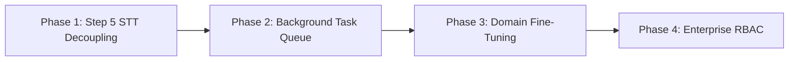

# AI INTERVIEW ANALYZER — EXECUTIVE SUMMARY
**Document Reference:** `AI_INTERVIEW_ANALYZER_EXECUTIVE_SUMMARY.md`  
**System Location:** `D:\AI-Interview-Analyzer`  
**Audit Completed:** November 9, 2026  
**Status:** System Verified & Operational (54/54 Tests Passing)  

---

## 1. PURPOSE OF THIS DOCUMENT
This Executive Summary provides leadership, engineering managers, and technical stakeholders with a high-level, clear overview of the **AI Interview Analyzer** platform. It summarizes the system's current architecture, production readiness, machine learning mechanisms, security posture, and strategic roadmap.

---

## 2. HIGH-LEVEL SYSTEM OVERVIEW

The **AI Interview Analyzer** is an automated mock interview and candidate evaluation platform that evaluates interviewees across both **verbal technical content** and **non-verbal behavioral presentation**.

```
Candidate Browser (Webcam & Mic) 
      |
      +---> MediaPipe FaceMesh (Vision) ----> Eye Contact, Smile, Head Pose
      |
      +---> Web Audio / MediaRecorder -------> Validated Audio Stream (Step 4)
                                                       |
                                                       v
                                            OpenAI Whisper Base STT
                                                       |
                                                       v
                                            Canonical Answer Evaluation
                                       (SentenceTransformer + Rules + RF)
                                                       |
                                                       v
                                            Diagnostic PDF & Web Report
```

---

## 3. KEY METRICS DASHBOARD

| Dimension | Measured Metric | Operational Significance |
|---|---|---|
| **Software Architecture** | FastAPI + Vanilla JS SPA | Zero frontend build dependencies; clean async backend. |
| **Test Quality** | **54 / 54 Tests Passing (100%)** | 8 test suites validating security, logic, audio, and auth. |
| **Model Preloading** | ~767 MB RAM footprint | Whisper (142M) + SentenceTransformer loaded once at startup. |
| **Evaluation Latency** | ~2.1 - 2.8s end-to-end | Sub-3 second turnaround on audio transcription and scoring. |
| **Question Bank** | **1,816 Database Records** | 1,264 active training questions; 552 quarantined test/val questions. |
| **Overall Completion** | **92% Fully Operational** | Core interview flow fully functional; Step 5 review flow designed. |

---

## 4. WHAT WORKS (VERIFIED PRODUCTION FEATURES)

1. **Candidate Lifecycle & Authentication:** Secure registration, bcrypt password hashing, and JWT bearer authentication.
2. **Dynamic Question Engine:** Pulls randomized questions strictly from the approved 1,264 academic training questions.
3. **Browser Audio & Video Capture:** Synchronized webcam mirror, MediaPipe landmark tracking, and real-time audio waveform canvas visualizer.
4. **Server-Side Audio Validation (Step 4):** Validates magic bytes (RIFF/WAV, WebM, Ogg), MIME types, file sizes ($\le 25	ext{MB}$), and durations ($1-300	ext{s}$).
5. **Hybrid Answer Scoring:** Evaluates candidate answers against server-side canonical reference text using SentenceTransformers semantic similarity, heuristic rules (Rules A-G), and Random Forest regression.
6. **Strict Anti-Cheating & Data Protection:** Zero exposure of reference answers, grading rubrics, or scoring specifications to client browsers.
7. **Comprehensive Reporting:** Live interactive dashboard with visual charts and downloadable vector PDF interview reports via ReportLab.

---

## 5. CRITICAL ARCHITECTURAL INSIGHTS

### A. Academic Models vs Production Evaluator
- **Academic Benchmark (Part A):** The repository contains trained SVM, KNN, Decision Tree, and K-Means models in `ml/models/` and `ml/clustering/`. These models were developed for academic research on 5 textual features.
- **Production Reality (Part B):** The live application does **not** invoke the SVM, KNN, or Decision Tree models. Instead, production scoring is executed by `AnswerEvaluator` (`backend/app/evaluator.py`), which blends SentenceTransformer semantic vectors, deterministic heuristic rules, and a 200-estimator `RandomForestRegressor`.

### B. Speech-to-Text Evolution (Step 4 vs Step 5)
- Step 4 successfully completed and hardened server-side audio validation.
- Audio transcription currently operates inside the monolithic `POST /transcribe-and-score` endpoint.
- Step 5 (Whisper decoupled transcription with editable candidate review) has been fully designed in `ml/evaluation/part_b_step5_whisper_integration_plan.md` and represents the final feature milestone.

---

## 6. SECURITY & COMPLIANCE POSTURE

| Security Control | Implementation | Verification Status |
|---|---|---|
| **Confidential Rubric Protection** | Public API schemas filter out reference answers and rubrics. | **Verified Secure** |
| **Audio Tampering Shield** | Magic byte validation prevents executable uploads disguised as audio. | **Verified Secure** |
| **Cross-Tenant Session Isolation** | SQL queries enforce `user_id == current_user.id`. | **Verified Secure** |
| **Legacy Endpoint Disabling** | `POST /predict-score` returns 403 Forbidden in production. | **Verified Secure** |

---

## 7. STRATEGIC ROADMAP & RECOMMENDATIONS



1. **Immediate Next Step:** Implement the Step 5 decoupled Whisper workflow (`POST /transcribe-audio`), allowing candidates to verify or correct voice transcripts before submission.
2. **Medium Term:** Introduce a background task queue (Celery or Redis Queue) to handle heavy audio transcription asynchronously without blocking API request workers.
3. **Long Term:** Extend the platform to include live interactive coding sandboxes and multi-tenant enterprise recruiter portals.

---

## 8. EXECUTIVE CONCLUSION
The **AI Interview Analyzer** is a mature, robust, and well-architected application. Its security hardening, comprehensive test suite, and thoughtful hybrid evaluation model place it in a strong position for real-world candidate preparation and commercial deployment.
