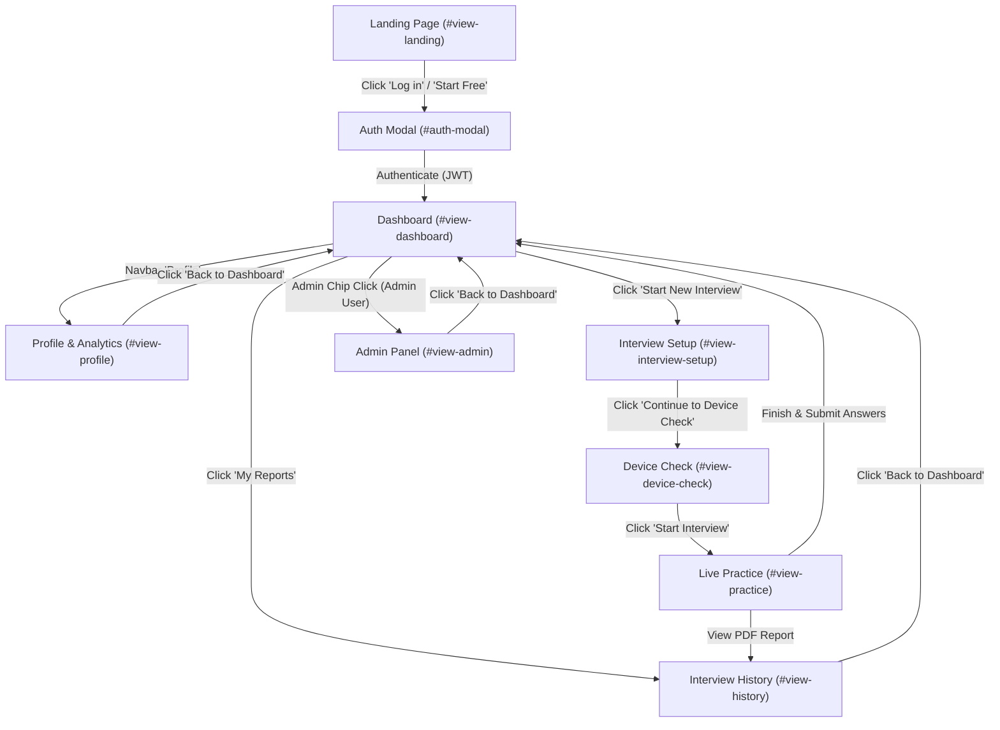

# AI INTERVIEW ANALYZER — MASTER ROUTE & NAVIGATION MAP
**Document Reference:** `ROUTE_AND_NAVIGATION_MAP.md`  
**Execution Timestamp:** 2026-11-11T11:35:00+05:30  
**Application Architecture:** Single-Page Application (SPA) with History API & Query/Hash Routing + FastAPI Asynchronous REST Backend

---

## 1. FRONTEND VIEW PANELS & ACCESS CONTROL

| View Name | Element ID | Auth Required | Admin Required | Primary Navigation Trigger | Target Description |
|---|---|:---:|:---:|---|---|
| **Landing** | `#view-landing` | No | No | Logo click, Back Home, Logout | 2026 SaaS Light Hero, Features, How It Works, Interactive Preview |
| **Dashboard** | `#view-dashboard` | **Yes** | No | Navbar "Dashboard", Login Success | Candidate metrics, progress gauge, quick start actions, focus areas |
| **Interview Setup**| `#view-interview-setup` | **Yes** | No | "Start Interview", "Start New Interview" | Role selection, experience level, question count, difficulty, resume link |
| **Device Check** | `#view-device-check` | **Yes** | No | "Continue to Device Check" in Setup | Webcam stream check, microphone level meter, WebRTC permissions |
| **Live Practice** | `#view-practice` | **Yes** | No | "Start Interview" in Device Check | Multi-modal interview room: video preview, audio visualizer, question deck |
| **User Profile** | `#view-profile` | **Yes** | No | Navbar "Profile", User dropdown | Candidate info, skills, education, target role, resume upload |
| **Analytics** | `#view-profile` (tab) | **Yes** | No | Navbar "Analytics", Dashboard links | Chronological score trend, practice duration, category readiness |
| **History** | `#view-history` | **Yes** | No | "My Reports", "View All" in Dashboard | List of past recorded MySQL sessions with detailed scores & PDF download |
| **Admin Panel** | `#view-admin` | **Yes** | **Yes** | Navbar "Admin Panel" (admins only) | System KPI metrics, candidate search, interview auditing, role promotion |

---

## 2. SYSTEM MODAL DIALOGS

| Modal ID | Trigger Element | Dismiss Trigger | Form / Action |
|---|---|---|---|
| `#auth-modal` | Navbar "Log in", protected route access | Close `×`, background click | Tabs for Login (`#login-form`) and Sign Up (`#register-form`) with password reveals |
| `#profile-modal` | First-time registration completion | Close `×`, "Continue to Dashboard" | Fills initial candidate name, target role, education, resume upload |
| `#privacy-modal` | Footer "Privacy" link | Close `×`, "Understood" button | Candidate data protection, local storage policy, audio privacy |
| `#terms-modal` | Footer "Terms" link | Close `×`, "Agree & Continue" button | Educational use terms, AI evaluation disclaimer |
| `#admin-delete-modal` | Delete candidate/interview in Admin | Close `×`, "Cancel", "Confirm" | Permanent database cascading deletion of candidate or session |

---

## 3. USER WORKFLOW TRANSITION GRAPH

---

## 4. BACKEND REST API ENDPOINTS

| HTTP Method | Route URL | Auth Required | Purpose |
|---|---|:---:|---|
| `GET` | `/health` | No | System health check & model readiness |
| `GET` | `/favicon.ico` | No | SVG brand favicon |
| `GET` | `/` | No | Redirect to `/frontend/` |
| `POST` | `/auth/register` | No | User registration with salted bcrypt hashing |
| `POST` | `/auth/login` | No | OAuth2 / JSON login returning stateless JWT token |
| `GET` | `/auth/me` | Yes | Get authenticated user info |
| `POST` | `/auth/logout` | Yes | Invalidate local session |
| `GET` | `/profile` | Yes | Get current user's profile |
| `PUT` | `/profile` | Yes | Update candidate skills, bio, target role |
| `POST` | `/profile/resume` | Optional | Upload & parse candidate resume (PDF/DOCX/TXT) |
| `GET` | `/profile/analytics` | Yes | Structured candidate performance metrics & trend |
| `GET` | `/profile/analytics/pdf` | Yes | Download branded PDF analytics report |
| `GET` | `/interview/questions` | Optional | Fetch filtered questions without rubrics |
| `POST` | `/interview/questions` | Optional | Generate personalized questions for candidate |
| `POST` | `/interview/audio/upload` | Yes | Step 4 audio validation (magic bytes, size, duration) |
| `POST` | `/transcribe-audio` | Yes | Decoupled Whisper STT transcription |
| `POST` | `/transcribe-and-score` | Yes | Monolithic STT + scoring endpoint |
| `POST` | `/evaluate-answer` | Yes | Canonical answer evaluation engine (Rules A-H) |
| `POST` | `/predict-score` | Yes | Legacy endpoint (Disabled 403 in production) |
| `POST` | `/visual-analysis` | Yes | Ingest 468 MediaPipe landmarks |
| `GET` | `/interviews` | Yes | Fetch candidate's own interview history |
| `POST` | `/interviews` | Yes | Persist completed interview session and results |
| `GET` | `/interviews/{id}` | Yes | Fetch single interview session details |
| `DELETE` | `/interviews/{id}` | Yes | Delete candidate interview session |
| `GET` | `/interviews/{id}/report` | Yes | Get structured interview evaluation report |
| `GET` | `/interviews/{id}/report/pdf`| Yes | Download vector PDF interview report |
| `GET` | `/admin/stats` | Admin | Get aggregated platform KPI statistics |
| `GET` | `/admin/users` | Admin | Search & list all registered candidates (paginated) |
| `GET` | `/admin/users/{id}` | Admin | Get full candidate record & all session history |
| `PUT` | `/admin/users/{id}/role` | Admin | Promote or demote candidate admin status |
| `GET` | `/admin/interviews` | Admin | Search & list all interview records across system |
| `GET` | `/admin/interviews/{id}` | Admin | Get full question results for any interview |
| `DELETE` | `/admin/users/{id}` | Admin | Permanently delete user and cascading records |
| `DELETE` | `/admin/interviews/{id}` | Admin | Permanently delete interview and question results |
