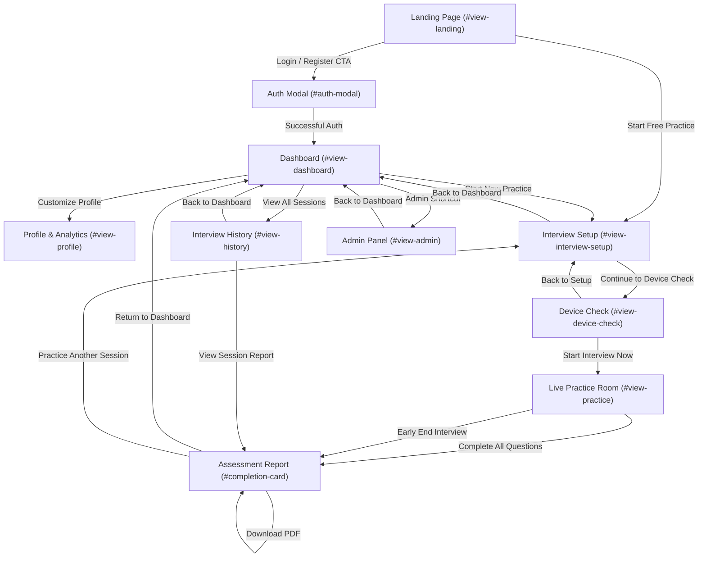

# AI INTERVIEW ANALYZER — COMPLETE ROUTE & DEPENDENCY MAP
**Document Reference:** `ROUTE_MAP.md`  
**Standard:** Enterprise Full-Stack Route & API Dependency Architecture  
**Target System:** `d:\AI-Interview-Analyzer`  
**Execution Timestamp:** 2026-11-11  

---

## 1. CLIENT-SIDE VIEW TRANSITION GRAPH



---

## 2. BACKEND REST API ENDPOINTS CATALOG

### Authentication Router (`/auth`)
| HTTP Method | URL Path | Function Name | Request Payload | Response Model | Auth Requirement |
|---|---|---|---|---|---|
| `POST` | `/auth/register` | `register` | `UserCreate` (email, password, full_name) | `TokenResponse` (token, user) | Public |
| `POST` | `/auth/login` | `login` | `UserLogin` (email, password) | `TokenResponse` (token, user) | Public |
| `GET` | `/auth/me` | `get_me` | None (Bearer token) | `UserResponse` | Authenticated User |
| `POST` | `/auth/logout` | `logout` | None (Bearer token) | `{"message": "Logged out"}` | Authenticated User |

### Candidate Profile & Analytics Router (`/profile`)
| HTTP Method | URL Path | Function Name | Request Payload | Response Model | Auth Requirement |
|---|---|---|---|---|---|
| `GET` | `/profile` | `get_user_profile` | None (Bearer token) | `UserProfileResponse` | Authenticated User |
| `PUT` | `/profile` | `update_user_profile` | `UserProfileUpdate` (skills, role, exp) | `UserProfileResponse` | Authenticated User |
| `POST` | `/profile/resume` | `upload_resume` | `multipart/form-data` (file) | `ResumeUploadResponse` | Authenticated User |
| `GET` | `/profile/analytics` | `get_profile_analytics` | None (Bearer token) | `ProfileAnalyticsResponse` | Authenticated User |
| `GET` | `/profile/pdf` | `get_profile_analytics_pdf`| None (Bearer token) | `application/pdf` stream | Authenticated User |

### Interview & Question Engine Router (`/interviews`, `/interview`)
| HTTP Method | URL Path | Function Name | Request Payload | Response Model | Auth Requirement |
|---|---|---|---|---|---|
| `GET` | `/interview/questions` | `get_questions` | Query (role, difficulty, count) | `List[QuestionPublicResponse]` | Public / Optional Auth |
| `POST` | `/interview/questions` | `get_questions_post` | `QuestionRequest` | `List[QuestionPublicResponse]` | Public / Optional Auth |
| `POST` | `/interviews` | `create_interview` | `InterviewCreate` | `InterviewResponse` | Authenticated User |
| `GET` | `/interviews` | `get_interviews` | None (Bearer token) | `List[InterviewSummary]` | Authenticated User |
| `GET` | `/interviews/{id}` | `get_interview_by_id` | Path param `{id}` | `InterviewDetailResponse` | Owner / Admin |
| `DELETE` | `/interviews/{id}` | `delete_interview` | Path param `{id}` | `{"message": "Deleted"}` | Owner / Admin |
| `GET` | `/interviews/{id}/report` | `get_interview_report` | Path param `{id}` | `ComprehensiveReportResponse` | Owner / Admin |
| `GET` | `/interviews/{id}/report/pdf` | `get_interview_pdf` | Path param `{id}` | `application/pdf` stream | Owner / Admin |
| `POST` | `/interviews/preview-pdf` | `preview_interview_pdf` | `PreviewPDFRequest` | `application/pdf` stream | Authenticated User |

### AI / Speech & ML Evaluation Endpoints
| HTTP Method | URL Path | Function Name | Request Payload | Response Model | Auth Requirement |
|---|---|---|---|---|---|
| `POST` | `/interview/audio/upload` | `upload_interview_audio`| `multipart/form-data` (audio file) | `AudioUploadResponse` | Authenticated User |
| `POST` | `/transcribe-audio` | `transcribe_audio` | `multipart/form-data` (audio file) | `{"transcript": str}` | Authenticated User |
| `POST` | `/evaluate-answer` | `evaluate_answer` | `AnswerEvaluationRequest` | `AnswerEvaluationResponse` | Authenticated User |
| `POST` | `/visual-analysis` | `analyze_visual_signals`| `VisualAnalysisRequest` | `VisualAnalysisResponse` | Authenticated User |
| `POST` | `/transcribe-and-score` | `transcribe_and_score` | `multipart/form-data` (audio + q_id) | `ComprehensiveEvaluationResponse` | Public / Optional Auth |

### Administrator Router (`/admin`)
| HTTP Method | URL Path | Function Name | Request Payload | Response Model | Auth Requirement |
|---|---|---|---|---|---|
| `GET` | `/admin/stats` | `get_admin_stats` | None (Bearer token) | `AdminStatsResponse` | Admin Only |
| `GET` | `/admin/users` | `list_admin_users` | Query (limit, offset, search) | `PaginatedUsersResponse` | Admin Only |
| `GET` | `/admin/users/{id}` | `get_admin_user_details`| Path param `{id}` | `AdminUserDetailResponse` | Admin Only |
| `PUT` | `/admin/users/{id}/role` | `update_user_role` | `RoleUpdateRequest` | `UserResponse` | Admin Only |
| `DELETE` | `/admin/users/{id}` | `delete_admin_user` | Path param `{id}` | `{"message": "User deleted"}` | Admin Only |
| `GET` | `/admin/interviews` | `list_admin_interviews`| Query (limit, offset) | `PaginatedInterviewsResponse` | Admin Only |
| `DELETE` | `/admin/interviews/{id}` | `delete_admin_interview`| Path param `{id}` | `{"message": "Interview deleted"}`| Admin Only |

---

## 3. PROTECTED ROUTE & SECURITY MATRIX

```
+------------------------+-------------------+---------------------------------------------------+
| Route / Panel          | Minimum Privilege | Enforcement Location                              |
+------------------------+-------------------+---------------------------------------------------+
| Landing (#view-landing)| Public            | None (Open to all visitors)                       |
| Auth Modal             | Public            | None (Login / Registration)                       |
| Dashboard              | Candidate User    | Client: navigateToView() -> redirect to auth modal|
|                        |                   | Server: Bearer Token required on /profile, /stats |
| Profile & Analytics    | Candidate User    | Client: navigateToView() -> redirect to auth modal|
|                        |                   | Server: Bearer Token required on /profile/resume  |
| Interview Setup        | Candidate User    | Client: navigateToView() -> redirect to auth modal|
| Device Check           | Candidate User    | Client: navigateToView() -> redirect to auth modal|
| Live Practice Room     | Candidate User    | Client: navigateToView() -> redirect to auth modal|
|                        |                   | Server: Bearer Token required on /evaluate-answer |
| Assessment Report      | Candidate User    | Client: navigateToView()                          |
|                        |                   | Server: User ID ownership check on interview id   |
| Interview History      | Candidate User    | Client: navigateToView() -> redirect to auth modal|
|                        |                   | Server: User ID query scoping on /interviews      |
| Admin Console          | Superadmin        | Client: currentUser.is_admin == true check        |
|                        |                   | Server: get_admin_user dependency on /admin/*     |
+------------------------+-------------------+---------------------------------------------------+
```
