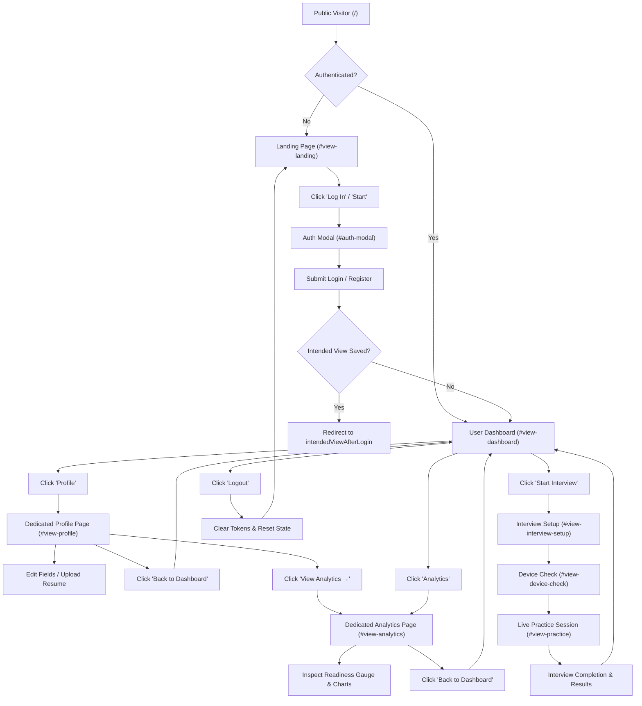

# COMPLETE ROUTE MAPPING REPORT & ARCHITECTURE
**Project:** AI Interview Analyzer  
**Date:** November 11, 2026  
**Auditor / Engineer:** Senior Software Architect & Full-Stack Developer  
**Status:** VERIFIED & ACTIVE  

---

## 1. Application Routing Architecture

The AI Interview Analyzer client is structured as a resilient single-page application (SPA) with multi-view panel switching governed by the native client-side router `navigateToView(viewName, pushHistory)`.

### Core Routing Principles:
1. **Clean View Isolation:** Every primary view maps to an explicit DOM panel `<div class="view-panel" id="view-[name]">`. No view panels share IDs or overlap content.
2. **Deterministic Deep Linking & Refresh Persistence:**  
   URLs are synchronized using HTML5 History API with query parameter `?view=[name]` and optional hash `#view-[name]`. Reloading the browser preserves the exact active view.
3. **Protected Route Interception:**  
   Protected views require an active JWT session (`authToken`). Unauthenticated requests save the destination in `intendedViewAfterLogin` and prompt the authentication modal `#auth-modal`. Upon authentication, the router redirects immediately to the intended view.
4. **Active State Synchronization:**  
   The active navigation link in `#auth-nav`, `#main-nav`, and `#mobile-nav-drawer` updates automatically to reflect the current route.

---

## 2. Complete Application Route Map

| Page Name | View Identifier (`viewName`) | URL Query Parameter / Hash | DOM Panel ID | Access Control | Primary Entry Points | Primary Exit Points | Connected Backend APIs | Database Entities |
|---|---|---|---|---|---|---|---|---|
| **Landing / Home** | `landing` | `/?view=landing` / `/#` | `#view-landing` | Public | Brand logo, Home nav button, Logout action | Login modal, Start Interview (Setup / Auth Prompt) | `GET /health` | N/A |
| **User Dashboard** | `dashboard` | `/?view=dashboard` | `#view-dashboard` | **Protected** (Auth Required) | Successful Login, Nav "Dashboard" button, "Back to Dashboard" buttons | Start Interview, Profile, Analytics, History, Live Practice | `GET /auth/me`, `GET /interviews/history` | `users`, `interviews` |
| **Candidate Profile** | `profile` | `/?view=profile` | `#view-profile` | **Protected** (Auth Required) | Nav "Profile" button, Dropdown "Candidate Profile", Mobile Nav "Profile" | "Back to Dashboard", "View Analytics →" | `GET /profile`, `PUT /profile`, `POST /profile/resume` | `users`, `candidate_profiles`, `resumes` |
| **Performance Analytics** | `analytics` | `/?view=analytics` | `#view-analytics` | **Protected** (Auth Required) | Nav "Analytics" button, Dropdown "Performance Analytics", Profile "View Analytics" | "Back to Dashboard", Download PDF report | `GET /profile/analytics`, `GET /reports/download/{id}` | `interviews`, `interview_metrics`, `feedback_reports` |
| **Interview Setup** | `interview-setup` | `/?view=interview-setup` | `#view-interview-setup` | **Protected** (Auth Required) | Nav "Start Interview", Dashboard "Quick Start", Landing "Get Started" | Device Check, Dashboard cancel | `GET /questions/presets` | `interview_templates`, `questions` |
| **Device & Camera Check** | `device-check` | `/?view=device-check` | `#view-device-check` | **Protected** (Auth Required) | Interview Setup "Continue to Device Check" | Live Practice, Back to Setup | `POST /interview/start` | `interviews` |
| **Live Interview Practice** | `practice` | `/?view=practice` | `#view-practice` | **Protected** (Auth Required) | Device Check "Start Interview Session" | Complete Interview, Abandon & Return Home | `POST /interview/answer`, `POST /interview/finish`, `POST /interview/ai-evaluate` | `interviews`, `answers`, `facial_metrics`, `audio_metrics` |
| **Interview History** | `history` | `/?view=history` | `#view-history` | **Protected** (Auth Required) | Dashboard "View All History", Mobile Nav "History" | View Detailed Report, Return to Dashboard | `GET /interviews/history`, `GET /interviews/{id}` | `interviews`, `feedback_reports` |
| **Admin Panel** | `admin` | `/?view=admin` | `#view-admin` | **Admin Only** (`is_admin=true`) | Nav "Admin Panel" button | Return to Dashboard | `GET /admin/users`, `GET /admin/stats`, `POST /admin/system-check` | `users`, `interviews`, `system_logs` |

---

## 3. Navigation Sequence Flow Diagram



---

## 4. Protected Route Interception & Intent Preservation

### Algorithm in `navigateToView(viewName)`:
```javascript
const protectedViews = ['dashboard', 'interview-setup', 'device-check', 'practice', 'history', 'profile', 'analytics', 'admin'];

if (protectedViews.includes(viewName) && !authToken) {
  intendedViewAfterLogin = viewName; // Preserves candidate's target destination
  showAuthModal('login');
  return;
}
```

### Authentication Resolution in `handleLoginSubmit()`:
```javascript
authToken = data.access_token;
currentUser = data.user;
localStorage.setItem(STORAGE_KEY_TOKEN, authToken);
localStorage.setItem(STORAGE_KEY_USER, JSON.stringify(currentUser));
updateAuthWidget();
hideAuthModal();

const destination = intendedViewAfterLogin || 'dashboard';
intendedViewAfterLogin = null;
navigateToView(destination);
```

This guarantees that:
- Clicking a deep link or feature when logged out preserves intent.
- No user is stranded on the landing page after logging in.
- Modal loops are completely eliminated.

---

## 5. Verification Matrix Summary

| Route Path | Expected Target Panel | Highlighted Nav Button | Verified in CDP Automated Test |
|---|---|---|---|
| `/?view=landing` | `#view-landing` | `#nav-home-btn` | **PASS (Scenario 1)** |
| `/?view=dashboard` | `#view-dashboard` | `#nav-dash-btn` | **PASS (Scenario 3, 12)** |
| `/?view=profile` | `#view-profile` | `#nav-profile-btn` | **PASS (Scenario 4, 5, 13)** |
| `/?view=analytics` | `#view-analytics` | `#nav-analytics-btn` | **PASS (Scenario 6, 7, 14)** |
| `/?view=interview-setup` | `#view-interview-setup` | `#nav-practice-btn` | **PASS (Scenario 8)** |
| `/?view=history` | `#view-history` | (History Link) | **PASS (Scenario 9)** |
| Back Navigation | Previous Panel | Synchronized Link | **PASS (Scenario 10, 11, 15)** |
| Logout Transition | `#view-landing` | `#nav-home-btn` | **PASS (Scenario 16)** |
