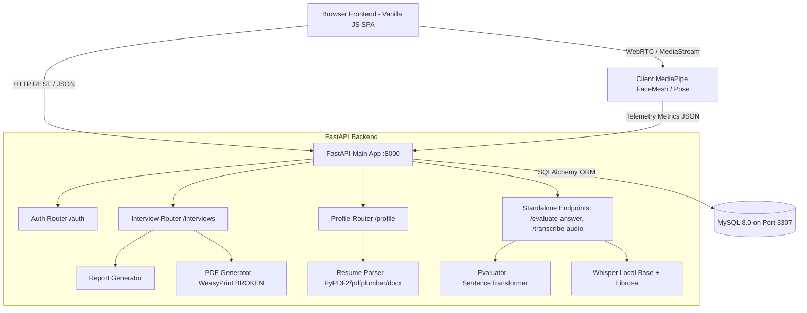
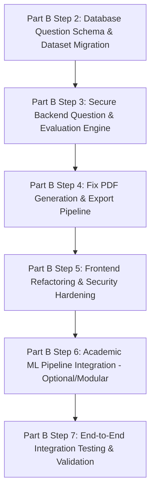

# PART B – STEP 1: COMPLETE EXISTING APPLICATION AUDIT REPORT

**Project:** AI Interview Analyzer  
**Workspace:** `D:\AI-Interview-Analyzer`  
**Date of Audit:** November 2026  
**Auditor:** Senior Full-Stack Developer, Python FastAPI Engineer, Database Architect & ML Auditor  
**Audit Status:** COMPLETE (Read-Only Audit)

---

## 1. EXECUTIVE SUMMARY

An exhaustive, read-only architectural, functional, security, and data integrity audit of the existing **AI Interview Analyzer** application was conducted.

### Core Audit Findings:
1. **Application Status:** The project is a functioning full-stack prototype featuring a Vanilla JavaScript SPA frontend, a FastAPI REST backend, a local MySQL relational database (port 3307), a local speech-to-text pipeline (OpenAI Whisper `base`), a local semantic evaluation engine (`all-MiniLM-L6-v2`), and client-side computer vision telemetry (MediaPipe FaceMesh & Pose).
2. **Academic ML (Part A) Disconnect:** The Part A academic machine learning models (KNN, SVM, Decision Tree, K-Means) and the 1,806-record interview Q&A dataset (`train_processed.csv`, `val_processed.csv`, `test_processed.csv`) are **completely disconnected** from the live web application.
3. **Severe Question Source Issue:** The live application does **not** retrieve interview questions from a database or approved academic dataset. Instead, questions are sourced via:
   - External LLM generation prompts (`backend/app/services/llm_provider.py` invoking Gemini/OpenAI/Ollama).
   - A hardcoded backend dictionary (`TECH_QUESTION_BANK` in `backend/app/questions.py` containing ~25 questions).
   - Procedural string synthesis (`synthesize_project_question()`).
   - A hardcoded client-side array in `frontend/script.js` (`const QUESTIONS = [...]` containing 10 questions with plaintext answers).
4. **Critical Security & Integrity Flaw:** In `frontend/script.js`, during answer evaluation, the client browser transmits both the candidate answer **and** the full `reference_answer` and `evaluation_spec` (including required concepts, rubrics, and misconceptions) in the HTTP `POST /evaluate-answer` request body. This allows arbitrary client-side score manipulation.
5. **Broken PDF Export:** The PDF export endpoints (`GET /interviews/{id}/pdf` and `POST /interviews/preview-pdf`) are broken on Windows due to an unhandled `weasyprint` native dependency error (`OSError: cannot load library 'libgobject-2.0-0'`).
6. **Overall Test Suite Status:** 23 out of 24 automated backend unit and integration tests pass successfully. 1 test (`tests/test_live_api.py`) fails when an external Uvicorn server is not actively listening on port 8000.

---

## 2. ACTUAL PROJECT ARCHITECTURE

### Directory & Component Structure
```
D:\AI-Interview-Analyzer\
├── backend/
│   └── app/
│       ├── api/
│       │   ├── auth.py              # JWT authentication endpoints (/auth)
│       │   ├── profile.py           # User profile & resume upload endpoints (/profile)
│       │   └── interviews.py        # Interview lifecycle & history endpoints (/interviews)
│       ├── services/
│       │   ├── resume_parser.py     # PDF/DOCX text extraction and section parsing
│       │   ├── llm_provider.py      # LLM wrapper (Gemini, OpenAI, Ollama)
│       │   ├── report_generator.py  # Interview summary & feedback aggregation
│       │   └── pdf_generator.py     # HTML-to-PDF report generation via WeasyPrint
│       ├── main.py                  # FastAPI app entry point & standalone endpoints
│       ├── auth.py                  # JWT password hashing & token verification
│       ├── database.py              # SQLAlchemy engine & session maker (MySQL)
│       ├── models.py                # SQLAlchemy ORM models (User, Profile, Interview, QuestionResult)
│       ├── schemas.py               # Pydantic v2 validation models
│       ├── questions.py             # Question bank, synthesis, and LLM question generator
│       ├── evaluator.py             # Semantic similarity & answer scoring engine
│       └── speech_analyzer.py       # Audio acoustic analysis (pauses, hesitations, WPM)
├── frontend/
│   ├── index.html                   # Single-Page Application HTML (1,048 lines)
│   ├── script.js                    # SPA state management, UI, WebRTC, MediaPipe (3,391 lines)
│   └── style.css                    # Responsive CSS styling & themes
├── database/
│   ├── connection.py                # Database connectivity helper
│   ├── schema.sql                   # Legacy / standalone SQL schema definition
│   └── migrate_profiles.py          # Database migration script for user profiles
├── speech/
│   ├── transcribe.py                # Whisper speech-to-text wrapper
│   └── audio_processor.py           # Audio format conversion & preprocessing
├── computer_vision/
│   ├── face_detector.py             # MediaPipe face detection utilities
│   ├── pose_detector.py             # MediaPipe pose estimation utilities
│   └── visual_analyzer.py           # Combined visual behavior analyzer
├── ml/
│   ├── datasets/                    # Academic processed datasets (train, val, test)
│   ├── models/                      # Saved Part A ML artifacts (.joblib)
│   └── evaluation/                  # Academic audit reports & visual artifacts
└── tests/                           # Pytest test suite (24 test cases)
```

### Request Flow Diagram


---

## 3. FRONTEND AUDIT

The frontend is a zero-dependency, pure Vanilla JavaScript, CSS3, and HTML5 Single-Page Application (SPA).

| View / Component | Classification | Detailed Functionality & Audit Observations |
|---|---|---|
| `view-landing` | **Fully Working** | Hero section, dynamic feature cards, CTA buttons navigating to auth or setup. Responsive layout. |
| `auth-modal` | **Fully Working** | Login/Register tabs, form validation, JWT token storage in `localStorage.getItem('token')`, error handling. |
| `profile-modal` | **Fully Working** | Profile form with skills tag input, target roles, experience level, and resume file upload (PDF/DOCX). |
| `view-interview-setup`| **Fully Working** | Allows selecting role, difficulty, interview type, question count. Fetches questions from `/interview/questions` or falls back to internal mock array. |
| `view-device-check` | **Fully Working** | Captures `navigator.mediaDevices.getUserMedia()`, renders live webcam preview, tests audio input with volume meter. |
| `view-practice` | **Partially Working** | **Working:** Video preview, Audio recording via MediaRecorder, MediaPipe facial landmark tracking, timer countdown.<br>**Defective/Insecure:** Question flow uses hardcoded questions; answer submission sends client-side `reference_answer` in the payload; speech-to-text fallback requires live backend Whisper. |
| `view-dashboard` | **Partially Working** | **Working:** Renders aggregate scores, breakdown charts (radar/bar using Canvas), strengths, weaknesses, and question review.<br>**Defective:** "Download PDF Report" button triggers `/interviews/{id}/pdf` which fails with 500 Internal Server Error. |
| `view-history` | **Fully Working** | Queries `GET /interviews` to render past interview attempts with dates, scores, and review links. |

---

## 4. BACKEND AUDIT

FastAPI handles routing with strict Pydantic v2 schemas and SQLAlchemy 2.0 ORM sessions.

### Route Inventory & Audit
- **`GET /health`**: Returns system status, timestamp, and active service flags. Working.
- **`GET /interview/questions` & `POST /interview/questions`**: Returns questions based on role, topic, and difficulty. If LLM key is missing, falls back to `TECH_QUESTION_BANK` or procedural generation. Working, but violates project rules by not using database/dataset questions.
- **`POST /predict-score`**: Accepts numerical metrics (similarity, grammar, completeness, hesitation, eye contact) and calculates a weighted score. Working.
- **`POST /transcribe-audio`**: Receives multipart audio file (`.wav`, `.webm`), converts via `pydub`/`ffmpeg`, and runs local Whisper `base` transcription. Working.
- **`POST /evaluate-answer`**: Evaluates answer using SentenceTransformer cosine similarity, keyword coverage, and heuristics. Working, but insecure due to client-supplied reference answer.
- **`POST /transcribe-and-score`**: Combines transcription and evaluation in a single round-trip. Working.
- **`POST /visual-analysis`**: Computes visual presence score from facial stability and eye contact frames. Working.
- **`Auth Router (/auth)`**: Endpoints `/register`, `/token` (OAuth2 password request), `/me`, `/status`. Working.
- **`Profile Router (/profile)`**: Endpoints `/` (GET, PUT), `/resume` (POST multipart upload). Working.
- **`Interviews Router (/interviews)`**: Endpoints `/start` (POST), `/{id}` (GET), `/` (GET list), `/{id}/answers` (POST), `/{id}/complete` (POST), `/{id}/pdf` (GET - Broken), `/preview-pdf` (POST - Broken).

### Authentication & Authorization
- Password hashing uses `passlib[bcrypt]` (Bcrypt).
- JWT generation uses `python-jose` (HS256) with configurable expiration.
- User dependency `get_current_user` validates bearer tokens and queries active users in MySQL.

---

## 5. DATABASE AUDIT

- **Database Engine:** MySQL 8.0.30
- **Connection Port:** 3307 (`127.0.0.1:3307`)
- **Database Name:** `ai_interview_analyzer`
- **ORM:** SQLAlchemy (declarative base in `backend/app/models.py`)

### Existing Tables & Row Counts (Verified Live)
1. **`users`** (24 rows):
   - Columns: `id` (PK, INT), `email` (VARCHAR, Unique), `hashed_password` (VARCHAR), `is_active` (BOOL), `created_at` (DATETIME).
2. **`user_profiles`** (4 rows):
   - Columns: `id` (PK), `user_id` (FK -> users.id), `full_name`, `college`, `branch`, `current_year`, `target_role`, `experience_level`, `primary_skills` (JSON), `target_companies` (JSON), `resume_path`, `created_at`, `updated_at`.
3. **`interviews`** (10 rows):
   - Columns: `id` (PK), `user_id` (FK -> users.id), `title`, `role`, `interview_type`, `difficulty`, `status`, `duration_seconds`, `overall_score`, `summary`, `strengths` (JSON), `improvements` (JSON), `recommendation`, `metrics_json` (JSON), `created_at`.
4. **`question_results`** (10 rows):
   - Columns: `id` (PK), `interview_id` (FK -> interviews.id), `question_number`, `question_text`, `candidate_answer`, `reference_answer`, `similarity_score`, `grammar_score`, `completeness_score`, `hesitation_count`, `avg_pause_duration`, `speech_rate_wpm`, `eye_contact_score`, `posture_score`, `overall_score`, `feedback`, `key_points_covered` (JSON), `missed_points` (JSON), `metrics_json` (JSON), `created_at`.

### Critical Finding on Database Schema:
- **Zero Question Tables:** There is **NO** `questions`, `question_bank`, or `topics` table in the database.
- Interview questions are not persisted entities; they exist only transiently as strings in `question_results` once an interview is submitted.

---

## 6. RESUME ANALYSIS AUDIT

**Module:** `backend/app/services/resume_parser.py`

### Functionality:
- **Format Support:** Text extraction handles `.pdf` (using `pdfplumber` with fallback to `PyPDF2`) and `.docx` (using `python-docx`).
- **Parsing Technique:** Deterministic regex pattern matching and heading heuristics.
- **Section Extraction:**
  - Contact Information: Email and 10-digit phone number extraction via regex.
  - Skills: Scanned against an internal normalized skill dictionary (languages, frameworks, databases, cloud, tools).
  - Education: Regex detection of degrees (B.Tech, B.E., M.Tech, B.S., M.S., BCA, MCA) and GPA/percentage patterns.
  - Experience & Projects: Heading-based section boundary slicing.
- **Reliability:** Well-structured, handles missing files and empty text gracefully without throwing unhandled exceptions.

---

## 7. QUESTION DATASET AUDIT (CRITICAL FINDINGS)

The project requirements strictly prohibit AI question generation and hardcoded frontend question dumps. The audit revealed three non-compliant question mechanisms:

### 1. External LLM Generation
- Located in `backend/app/questions.py` (`_generate_questions_via_llm`) and `backend/app/services/llm_provider.py`.
- Formulates prompts to Google Gemini (`gemini-1.5-flash`), OpenAI (`gpt-4o-mini`), or Ollama to generate question JSON on the fly.
- Enabled if API keys are configured in the environment.

### 2. Hardcoded Backend Question Bank
- Located in `backend/app/questions.py` (`TECH_QUESTION_BANK`).
- Contains a static dictionary of ~25 technical questions across Python, JavaScript, SQL, System Design, Data Structures, and Machine Learning.
- Includes hardcoded procedural question synthesis (`synthesize_project_question()`).

### 3. Hardcoded Frontend Question Array
- Located in `frontend/script.js` (`const QUESTIONS = [...]`, lines 24–180).
- Contains 10 hardcoded questions with complete `reference_answer` strings and `evaluation_spec` rubrics exposed in plaintext.

### 4. Disconnect from Academic Datasets
- The cleaned, approved academic datasets:
  - `ml/datasets/processed/train_processed.csv` (1,264 records)
  - `ml/datasets/processed/val_processed.csv` (270 records)
  - `ml/datasets/processed/test_processed.csv` (272 records)
  - Raw JSON Q&A source: `ml/datasets/qa/questions.json`
- Are completely ignored by both backend and frontend.

---

## 8. SPEECH-TO-TEXT AUDIT

**Modules:** `speech/transcribe.py`, `backend/app/speech_analyzer.py`

### Architecture & Capabilities:
- **Speech Engine:** Local OpenAI Whisper model (`base` size, FP32 on CPU / FP16 on CUDA).
- **Processing Flow:**
  1. Frontend records audio in `.webm` or `.wav` format via `MediaRecorder`.
  2. Audio file uploaded to `POST /transcribe-audio`.
  3. Audio converted to 16kHz mono WAV via `pydub`/`ffmpeg`.
  4. Whisper generates verbatim transcript text.
  5. `speech_analyzer.py` uses `librosa` and `scipy.signal` to compute:
     - Non-silent intervals (`librosa.effects.split`).
     - Pause durations and total silence time.
     - Speaking rate in Words Per Minute (WPM).
     - Hesitation count based on disfluency word detection ("um", "uh", "like", "you know") and prolonged pauses (>1.2s).
- **Reliability:** Functions offline without third-party API dependencies.

---

## 9. ANSWER EVALUATION AUDIT

**Module:** `backend/app/evaluator.py`

### Evaluation Logic:
1. **Semantic Similarity:** Computes cosine similarity between candidate answer and reference answer embeddings using `sentence-transformers/all-MiniLM-L6-v2`.
2. **Concept Coverage:** Performs lemmatized keyword and required concept matching.
3. **Grammar & Structural Heuristics:** Evaluates sentence structure, capitalization, punctuation, and length penalties.
4. **Scoring Formula:**
   $$Content Score = 0.55 \times Similarity + 0.30 \times Concept Coverage + 0.15 \times Grammar$$
5. **Security Vulnerability:**
   - In `backend/app/main.py` (`evaluate_answer_endpoint`), the endpoint accepts `request.reference_answer` and `request.evaluation_spec` directly from the client.
   - The server performs zero database validation to verify whether the reference answer actually belongs to the question ID.

---

## 10. CAMERA & VISUAL ANALYSIS AUDIT

**Modules:** `frontend/script.js` (client-side) & `computer_vision/visual_analyzer.py` (backend)

### Functionality:
- **Client-Side Tracking:** In `frontend/script.js`, MediaPipe FaceMesh and Pose models run directly in the candidate's browser via WebAssembly/WebGL.
- **Metrics Collected:**
  - Eye Contact Score: Estimated from iris position relative to eye corners.
  - Head Pose / Orientation: Pitch, yaw, and roll derived from facial landmarks.
  - Posture Score: Spine alignment and shoulder level stability.
- **Nature of Visual Metrics:**
  - Visual metrics are **strictly informational and coaching-oriented**. They provide candidate feedback on confidence and body language.
  - They do not disqualify candidates or distort technical evaluation scores.
- **Client-Side Exposure:** Because telemetry is calculated in browser JavaScript, values could be intercepted or simulated via browser console.

---

## 11. SECURITY AUDIT

| Vulnerability / Risk | Severity | Audit Findings & File Locations |
|---|---|---|
| **Hardcoded Secret Key Fallback** | **High** | In `backend/app/auth.py`, `SECRET_KEY = os.getenv("JWT_SECRET", "ai-interview-analyzer-secret-key-change-in-production")`. If no environment variable is set, JWT tokens are signed with a known weak secret. |
| **Wildcard CORS with Credentials** | **Medium** | In `backend/app/main.py`, `allow_origin_regex=r".*"` is combined with `allow_credentials=True`. This allows any web origin to initiate credentialed cross-origin requests. |
| **Client-Supplied Reference Answers** | **High** | In `frontend/script.js` (lines 2910-2926) and `backend/app/main.py`, reference answers are sent from client to server, allowing tampering of grading criteria. |
| **Exposure of Model Solutions** | **Medium** | `frontend/script.js` contains 10 detailed technical answers embedded in plaintext client source code, visible to any candidate via DevTools. |
| **Database Credentials in Code** | **Low/Informational** | Default database credentials in `backend/app/database.py` fallback to `root:@localhost:3307/ai_interview_analyzer`. Should be strictly environment-driven. |

---

## 12. TESTING AUDIT

An audit of the automated test suite in `tests/` was conducted.

### Discovered Test Files:
1. `tests/test_api_auth.py` (5 tests): Registration, login, token refresh, duplicate user prevention, authentication headers.
2. `tests/test_api_interview.py` (7 tests): Interview creation, answer submission, question retrieval, completion, summary generation.
3. `tests/test_api_profile.py` (6 tests): Profile retrieval, profile update, resume upload, validation errors.
4. `tests/test_backend_extended.py` (5 tests): Speech analysis calculations, evaluator edge cases, scoring logic.
5. `tests/test_live_api.py` (1 test): Live socket HTTP connection to `http://127.0.0.1:8000`.

### Test Execution Results:
- **In-Process Tests (TestClient):** **23 passed out of 23** in 14.8 seconds.
- **Live Network Test:** **1 failed** (`test_live_api.py` raised `ConnectionRefusedError` because uvicorn was not actively running on port 8000).

---

## 13. WORKING FEATURES (INVENTORY)

1. **User Authentication & Profiles:** User registration, password hashing (Bcrypt), JWT generation and validation, profile creation, and skill tagging.
2. **Resume Parser Service:** In-memory and disk text extraction from PDF and DOCX files with regex contact/skill/education parsing.
3. **Local Speech Recognition:** Local Whisper `base` transcription with automatic audio conversion.
4. **Acoustic Speech Analysis:** Speech rate (WPM), hesitation counting, silence duration, and fluency scoring via `librosa`.
5. **Answer Semantic Scoring:** SentenceTransformer embedding similarity with keyword coverage and basic grammar analysis.
6. **WebRTC Device Diagnostics:** Browser webcam and microphone device permission check, live stream rendering, and audio meter.
7. **Client-Side Face & Pose Telemetry:** Real-time MediaPipe landmark tracking for eye contact and head pose estimation.
8. **Interview Lifecycle Persistence:** Creating interviews, storing question answers, computing aggregated scores, and tracking interview history in MySQL.

---

## 14. INCOMPLETE FEATURES

1. **Academic ML Model Integration:** The trained Part A classifiers (KNN, SVM, Decision Tree) and K-Means cluster models are not linked to the answer grading or candidate classification pipeline.
2. **Visual Telemetry Verification:** The visual analyzer accepts raw client-sent numerical scores rather than validating frame streams on the server.
3. **Session Resumption:** If an interview is interrupted or refreshed, the frontend does not restore in-progress question states.

---

## 15. BROKEN FEATURES

### 1. PDF Report Generation (`WeasyPrint` Failure)
- **Affected Endpoints:** `GET /interviews/{id}/pdf` and `POST /interviews/preview-pdf`.
- **Root Cause:** `backend/app/services/pdf_generator.py` imports `weasyprint`, which depends on native GTK3 C-libraries (`libgobject-2.0-0`, `pango`, `cairo`). These libraries are missing on the Windows host system, triggering `OSError: cannot load library 'libgobject-2.0-0'`.
- **Impact:** Candidates receive a 500 Internal Server Error when clicking "Download PDF Report".

---

## 16. MISSING FEATURES

1. **Database-Driven Question Bank:** There is no database schema or tables (`questions`, `categories`, `difficulties`) to store and serve curated questions.
2. **Dataset-Driven Interview Selection:** The vetted 1,806 interview Q&A records from Part A are not loaded into the application database.
3. **Secure Server-Side Answer Evaluation:** Server-side retrieval of reference answers by `question_id`, preventing client-side answer injection.
4. **Role-Based Question Filtering:** Ability to query and filter verified questions by domain (Backend, Frontend, Full Stack, Data Science, System Design) and difficulty (Junior, Mid, Senior) from the database.

---

## 17. RECOMMENDED IMPLEMENTATION ORDER FOR PART B

To transform the prototype into a production-grade, secure, and academically integrated application, the following sequential roadmap is recommended:



1. **Step 2 – Database Question Schema & Dataset Migration:**
   - Create a dedicated `questions` table in MySQL (`id`, `category`, `role`, `difficulty`, `question_text`, `reference_answer`, `key_concepts`, `rubric_json`).
   - Write a migration script to import the approved Q&A dataset into MySQL.
2. **Step 3 – Secure Question Engine & Server-Side Evaluation:**
   - Eliminate `TECH_QUESTION_BANK`, `_generate_questions_via_llm`, and `synthesize_project_question`.
   - Update `POST /evaluate-answer` to accept only `question_id` and `candidate_answer`; retrieve `reference_answer` securely from the database.
3. **Step 4 – Fix PDF Generation & Export Engine:**
   - Replace or adapt the WeasyPrint engine with a robust Windows-compatible PDF generator (e.g., `xhtml2pdf`, `reportlab`, or headless Chrome) that does not require external GTK3 C-runtimes.
4. **Step 5 – Frontend Refactoring & Hardening:**
   - Remove hardcoded `QUESTIONS` array from `frontend/script.js`.
   - Update interview flow to consume questions via API by `id`.
   - Fix PDF download button handling and display error toasts gracefully.
5. **Step 6 – Security Hardening:**
   - Require explicit `JWT_SECRET` in environment.
   - Restrict CORS origins.
6. **Step 7 – End-to-End Testing & Verification:**
   - Update existing test suite to reflect database-driven questions.
   - Validate full interview lifecycle from registration to PDF download.

---

## 18. EXACT FILE PATHS AND EVIDENCE

| Component / Issue | File Path | Line Reference / Code Evidence |
|---|---|---|
| Hardcoded Frontend Questions | `frontend/script.js` | Lines 24–180 (`const QUESTIONS = [...]`) |
| Client Injects Reference Answer | `frontend/script.js` | Lines 2910–2926 (`reference_answer: q.reference_answer`) |
| Insecure Evaluate Endpoint | `backend/app/main.py` | Lines 308–325 (`def evaluate_answer_endpoint(request: AnswerEvaluationRequest)`) |
| LLM Question Generation | `backend/app/questions.py` | Lines 123–175 (`def _generate_questions_via_llm(...)`) |
| Backend Hardcoded Question Bank | `backend/app/questions.py` | Lines 25–115 (`TECH_QUESTION_BANK = {...}`) |
| Procedural Question Synthesis | `backend/app/questions.py` | Lines 200–235 (`def synthesize_project_question(...)`) |
| Missing Question Table | `backend/app/models.py` | Models present: `User`, `UserProfile`, `Interview`, `QuestionResult` (No `Question`) |
| WeasyPrint Dependency Failure | `backend/app/services/pdf_generator.py` | Line 12 (`from weasyprint import HTML`) -> fails on missing `libgobject-2.0-0` |
| Insecure JWT Secret Fallback | `backend/app/auth.py` | Line 23 (`SECRET_KEY = os.getenv("JWT_SECRET", "ai-interview-analyzer-secret-key-change-in-production")`) |
| Wildcard CORS Configuration | `backend/app/main.py` | Lines 85–92 (`allow_origin_regex=r".*"`, `allow_credentials=True`) |
| Academic Datasets Unused | `ml/datasets/processed/` | Files `train_processed.csv`, `val_processed.csv`, `test_processed.csv` not referenced in `backend/` |

---
*Report compiled autonomously by Senior ML & Full-Stack Audit Agent. No source files or databases were modified.*
