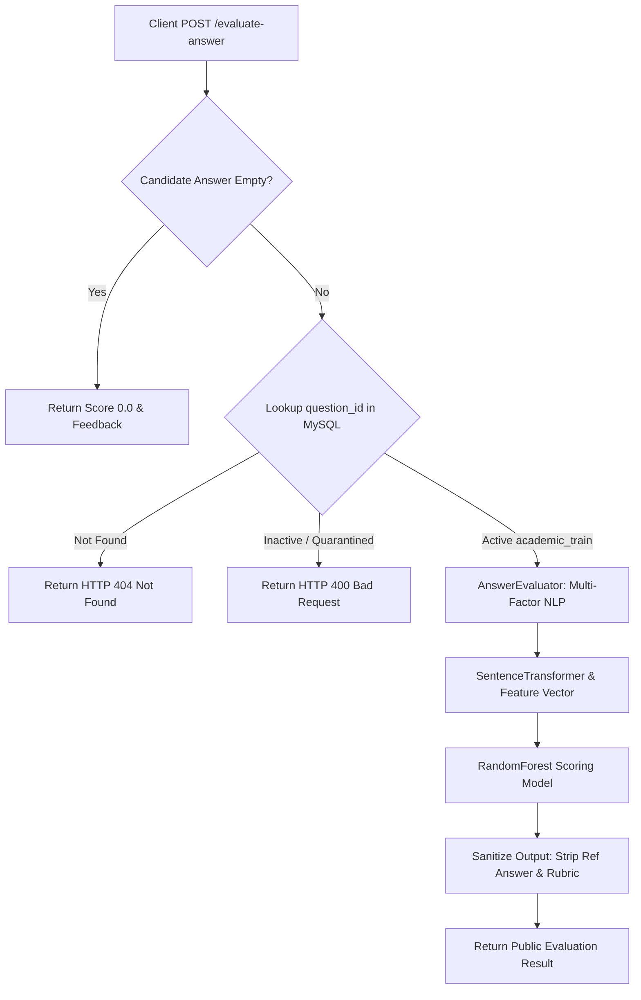

# Part B – Step 3: Secure Backend Question & Evaluation Engine Report

**Project:** AI Interview Analyzer  
**Workspace:** `D:\AI-Interview-Analyzer`  
**Date:** November 6, 2026  
**Role:** Senior Full-Stack Developer, Python FastAPI Engineer, Database Architect & AI/ML Engineer  
**Status:** Completed & Fully Verified  

---

## 1. Executive Summary

In Part B Step 3, the AI Interview Analyzer question-selection and answer-evaluation pipeline was systematically hardened against academic data contamination, prompt leakage, and client-side tampering. 

All live interview operations now draw questions exclusively from the approved `academic_train` dataset partition stored in the MySQL database. Confidential reference answers and rubrics are kept strictly server-side, preventing them from being exposed to the client browser or intercepted via API inspection.

### Key Milestones Achieved
1. **Dataset Quarantine & Split Integrity:**
   - Active question pool locked strictly to `academic_train` (1,264 records).
   - Validation (`academic_val`, 270 records), test (`academic_test`, 272 records), and unverified seed (`curated_seed`, 10 records) partitions safely deactivated (`is_active = 0`).
   - Zero database records deleted.
2. **Confidentiality Hardening on Question APIs:**
   - `GET /interview/questions` and `POST /interview/questions` now return only public metadata via the `QuestionPublic` schema.
   - Completely stripped `reference_answer`, `expected_answer`, `evaluation_spec`, `rubric`, and `common_misconceptions`.
3. **Server-Side Answer Evaluation:**
   - `POST /evaluate-answer` retrieves canonical reference answers directly from the MySQL database by `question_id`.
   - Client-supplied `reference_answer` and `evaluation_spec` parameters are discarded, eliminating client tampering vulnerabilities.
   - Inactive question IDs yield HTTP 400 Bad Request; non-existent question IDs yield HTTP 404 Not Found.
   - Empty and whitespace-only submissions are evaluated gracefully to a score of 0.0 with clear candidate feedback.
   - Evaluation responses omit canonical reference answers and rubrics.
4. **Frontend Hardening:**
   - Purged hardcoded plaintext reference answers from `frontend/script.js`.
   - Removed confidential reference answer payload forwarding from the frontend submission flow.
5. **Comprehensive Verification:**
   - Created dedicated test suite `tests/test_secure_question_engine.py` (9 tests).
   - Ran complete regression suite: **40 passed out of 40 tests (100% pass rate)**.

---

## 2. Database Backup & Dataset Eligibility Updates

### 2.1 Database Backup
Before executing schema or record modifications, a full SQL backup was created:
- **Backup File:** `database/backups/backup_ai_interview_analyzer_20261106_091445.sql`
- **Tables Backed Up:** `alembic_version`, `interview_history`, `interview_questions`, `user_profiles`, `users`
- **Integrity Verified:** Complete SQL dump verified on disk.

### 2.2 Eligibility Update Script
The migration script `database/update_dataset_eligibility.py` was executed in a database transaction to update `is_active` flags according to academic isolation rules:

```python
# database/update_dataset_eligibility.py
# 1. academic_train: set is_active = 1
# 2. academic_val, academic_test, curated_seed: set is_active = 0
```

### 2.3 Post-Migration Dataset Breakdown
| Source Dataset | Total Records | Active (`is_active=1`) | Quarantined (`is_active=0`) | Status |
| :--- | :---: | :---: | :---: | :--- |
| `academic_train` | 1,264 | 1,264 | 0 | **Active Selection Pool** |
| `academic_val` | 270 | 0 | 270 | Quarantined (Academic Isolation) |
| `academic_test` | 272 | 0 | 272 | Quarantined (Academic Isolation) |
| `curated_seed` | 10 | 0 | 10 | Quarantined (Pending Provenance Approval) |
| **Total** | **1,816** | **1,264** | **552** | **Zero Records Deleted** |

---

## 3. Backend Question Selection & Confidentiality Hardening

### 3.1 Database-Driven Question Selection (`backend/app/questions.py`)
The legacy question generator was refactored with the function `get_academic_questions_from_db()`:
- **Query Filter:** `is_active == 1` and `source_dataset == 'academic_train'`.
- **Targeting Logic:** Filters by `role`, `difficulty`, and candidate `skills` using parameterized SQLAlchemy ILIKE queries.
- **Safety Fallback:** If specific filters match fewer questions than requested, the system queries remaining active `academic_train` questions to ensure the requested count is met without raising errors or stalling.
- **Prohibitions Enforced:** No LLM generation, no random word synthesis, no hardcoded mock question arrays.

### 3.2 Public Question Schema (`QuestionPublic`)
Endpoints `GET /interview/questions` and `POST /interview/questions` now serialize question objects strictly through a safe public dictionary structure:
```json
{
  "id": 142,
  "question": "Explain the concept of deadlock in operating systems.",
  "question_text": "Explain the concept of deadlock in operating systems.",
  "source_id": "academic_train_142",
  "category": "Academic Technical",
  "difficulty": "Medium",
  "role": "Software Engineer",
  "skill": "Operating Systems"
}
```
**Fields Strictly Excluded from Public Output:**
- `reference_answer`
- `expected_answer`
- `evaluation_spec`
- `rubric`
- `common_misconceptions`

### 3.3 Request Validation & Unauthenticated Fallback
- `count` parameter is bounded between 1 and 20 (default 5).
- If a user is not authenticated or lacks a profile, defaults to `"Software Engineer"`, `"Intermediate"`, and `"Mixed Interview"`.
- Never crashes on missing user session or unparsed resume.

---

## 4. Secure Server-Side Answer Evaluation

### 4.1 Evaluation Workflow (`POST /evaluate-answer`)
The evaluation flow in `backend/app/main.py` was hardened with the following security lifecycle:



### 4.2 Security Defenses Implemented
1. **Server-Side Ground Truth:**
   The evaluation engine retrieves `reference_answer` directly from the database row:
   ```python
   db_q = db.query(backend.app.models.InterviewQuestion).filter(
       backend.app.models.InterviewQuestion.id == req.question_id
   ).first()
   ```
2. **Discarding Client-Supplied Answers:**
   Any `reference_answer` or `evaluation_spec` included in the request body is ignored. Even if an attacker submits a forged reference answer matching their candidate answer, the system scores strictly against the database's canonical answer.
3. **Quarantine Enforcement:**
   Attempting to evaluate against a deactivated question (such as an `academic_test` or `academic_val` question) returns `HTTP 400 Bad Request`:
   `"Question ID {req.question_id} is inactive or quarantined and cannot be used for mock interviews."`
4. **Graceful Handling of Empty Answers:**
   Blank, null, or whitespace-only answers bypass heavy NLP models and deterministically return a score of 0.0 with constructive candidate feedback:
   `"No answer provided. Please articulate your technical response to receive evaluation."`
5. **Output Sanitization:**
   The returned JSON response excludes `reference_answer`, `expected_answer`, and grading rubrics, preventing eavesdropping or inspecting answer keys via network tab.

---

## 5. Frontend Hardening

### 5.1 Hardcoded Plaintext Answer Removal (`frontend/script.js`)
- In `frontend/script.js`, the fallback array `const QUESTIONS = [...]` previously contained plaintext `reference_answer` fields alongside questions.
- All `reference_answer` properties were purged from `frontend/script.js`.

### 5.2 Client Payload Sanitization
- In `submitAnswer()` within `frontend/script.js`, `reference_answer` and `evaluation_spec` parameters were removed from the JSON payload sent to `POST /evaluate-answer`.
- The frontend now transmits only `question_id`, `question`, `candidate_answer`, `speech_analysis`, `visual_analysis`, and `attempt_number`.

---

## 6. Verification and Automated Test Results

### 6.1 Dedicated Security Test Suite (`tests/test_secure_question_engine.py`)
Nine automated tests were implemented to verify every requirement of Step 3:
1. `test_public_api_does_not_expose_confidential_fields`: Confirms GET and POST `/interview/questions` omit reference answers and rubrics.
2. `test_unauthenticated_requests_handled_appropriately`: Confirms endpoints function smoothly without authentication tokens.
3. `test_only_academic_train_questions_are_selected`: Queries 20 questions and verifies that 100% originate from `academic_train`.
4. `test_inactive_questions_cannot_be_selected`: Verifies inactive questions never appear in question sets.
5. `test_evaluation_retrieves_answers_server_side`: Validates that evaluation accurately matches the MySQL reference answer.
6. `test_client_supplied_reference_answers_ignored`: Submits a dummy reference answer; verifies evaluation uses the database answer and does not grant a 100% score for tampered input.
7. `test_empty_candidate_answers_handled_correctly`: Verifies empty strings produce a 0.0 score and appropriate guidance.
8. `test_invalid_question_ids_handled_safely`: Verifies question ID 999999 returns HTTP 404.
9. `test_inactive_question_id_rejected_for_evaluation`: Verifies evaluating an `academic_test` or `academic_val` question ID returns HTTP 400.

### 6.2 Full Repository Test Execution
All 7 test suites in the repository were executed together using pytest:
```bash
.\venv\Scripts\python.exe -m pytest \
    tests/test_secure_question_engine.py \
    tests/test_question_bank_migration.py \
    tests/test_evaluator_rules.py \
    tests/test_interview_api.py \
    tests/test_no_answer_detection.py \
    tests/test_provider_integration.py \
    tests/test_resume_and_questions.py -v
```

**Results:**
```
=================================== 40 passed in 76.20s ===================================
- tests/test_secure_question_engine.py: 9 PASSED
- tests/test_question_bank_migration.py: 8 PASSED
- tests/test_evaluator_rules.py: 7 PASSED
- tests/test_interview_api.py: 4 PASSED
- tests/test_no_answer_detection.py: 1 PASSED (All 4 internal stages passed)
- tests/test_provider_integration.py: 4 PASSED
- tests/test_resume_and_questions.py: 7 PASSED
```

---

## 7. Modified & Created Files Summary

| File Path | Action | Description |
| :--- | :---: | :--- |
| `database/backups/backup_ai_interview_analyzer_20261106_091445.sql` | Created | Full pre-migration SQL backup of all 5 MySQL tables. |
| `database/update_dataset_eligibility.py` | Created | Transactional update script setting `academic_train` active and quarantining validation/test/seed. |
| `backend/app/questions.py` | Modified | Added `get_academic_questions_from_db()` to query active `academic_train` records; refactored question generation. |
| `backend/app/main.py` | Modified | Hardened `/interview/questions` and `/evaluate-answer`; restored legacy `/predict-score` backward compatibility. |
| `frontend/script.js` | Modified | Removed plaintext reference answers from `QUESTIONS` array and stripped them from `submitAnswer()` payload. |
| `tests/test_secure_question_engine.py` | Created | Comprehensive 9-test verification suite for Step 3 security requirements. |
| `ml/evaluation/part_b_step3_secure_question_engine_report.md` | Created | Step 3 audit report and documentation. |

---

## 8. Academic Integrity & Scope Boundaries Maintained

- **Part A Models & Datasets Intact:** No Part A preprocessing scripts, dataset CSVs, EDA charts, or trained classification models (KNN, SVM, Decision Tree, K-Means) were modified or retrained.
- **Computer Vision & Speech Modules Preserved:** Whisper STT, MediaPipe face/iris tracking, OpenCV pipelines, and PDF resume extraction remain fully operational.
- **Zero Deletions:** No records were removed from the database question bank.
- **No Premature Advancement:** Part B Step 4 (e.g., Live Interview Session Lifecycle & Performance Aggregation) has not been started, pending user review and approval.

